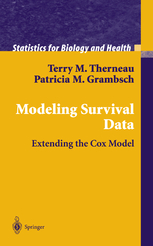

```{r setup, include=FALSE, echo=FALSE, warning=FALSE, cache=FALSE}
#| cache.extra: !expr tools::md5sum("_common.R")
options(htmltools.dir.version = FALSE)

# cache.extra above: knitr keys the cache on the chunk's own code, not on files
# it sources, so a palette edit in _common.R would otherwise leave cached figures
# drawing the old colors.

# R starts in the C locale here, which cannot encode non-ASCII characters. Any
# Greek letter, minus sign, or +/- typed into a ggplot title, subtitle, axis
# label, or annotation gets drawn as the literal text <U+03B1>. Setting a UTF-8
# ctype fixes it for the whole document.
Sys.setlocale("LC_CTYPE", "en_US.UTF-8")

knitr::opts_chunk$set(fig.retina = 2, fig.align = "center",
                      warning = FALSE, error = FALSE, message = FALSE)

library(here)
library(tidyverse)
library(survival)
library(modelsummary)
library(kableExtra)
library(patchwork)
library(MASS)       # mvrnorm, for simulating coefficients

source("_common.R")   # Binghamton palette + theme_bu()

# MASS masks dplyr::select
select <- dplyr::select

set.seed(20261101)

# Running data: ParlGov cabinets, 1945 to June 2023, one row per cabinet.
# Built by make-cabinets.R; duration in months, fail = 1 if the cabinet fell
# (replaced between elections, or an early election), 0 if it ran to a
# regular election or was still in office when the data end.
cab <- read_csv(here::here("data", "cabinets.csv"), show_col_types = FALSE)

# Second: the Week 5 leader-years (Archigos joined to Polity V), used only in
# the counts-and-hazards section at the end.
leaders <- read_csv(here::here("data", "leaderyears.csv"), show_col_types = FALSE) %>%
  mutate(leftoffice = if_else(exitreason == "Still in Office", 0L, leftoffice),
         yrborn = na_if(yrborn, -999),
         age    = year - yrborn) %>%
  arrange(obsid, year) %>%
  group_by(obsid) %>%
  mutate(t = row_number()) %>%          # survival time, within the spell
  ungroup()

polity <- read_csv(here::here("data", "p5v2018.csv"), show_col_types = FALSE) %>%
  select(ccode, year, polity2)

lt <- leaders %>%
  left_join(polity, by = c("ccode", "year"), relationship = "many-to-one") %>%
  filter(!is.na(polity2), !is.na(age))
```

<style>
table, th, td { font-size: 18px; }
tr:nth-child(odd) { background-color: #f2f2f2; }
</style>

# Goals

In [Week 5](discretehazards26.html) we built hazard models in discrete time, one row per unit per period. In [Week 8](countA26.html) we saw that the same events can be counted, and that a Poisson with an offset reproduces the discrete-time hazards. This week:

- **Continuous-time hazard models** — one row per spell, with survival time and a failure indicator as the outcome: the exponential, the Weibull, and the Cox model.
- **Ties and non-proportional hazards**, and what to do about them.
- **Counts and hazards, one last time**: each of these models is a Poisson regression on suitably arranged data.

The punchline: **every model in these notes maximizes the same likelihood we wrote down in Week 5** — failures contribute the density $f(t)$, censored spells the survivor function $S(t)$. The models differ only in what they assume about the shape of the hazard, $h(t)$: the exponential says it's flat, the Weibull says it's monotonic, and the Cox model declines to say. And each is a Poisson regression you could estimate with `glm`, so counts, discrete-time hazards, and continuous-time hazards are one family.

The approach is the same one we've used for *any* limited $y$ variable all semester:

1. What does $y$ look like, and what distribution describes it?
2. Write the likelihood.
3. Parameterize — make the distribution's parameter a function of $x\beta$.
4. Estimate.
5. Interpret through quantities of interest, and visualize them.
6. Check the assumptions.

As a running example, I'll use how long governments last in parliamentary democracies, step by step; [The cabinet analysis, start to finish](#the-cabinet-analysis-start-to-finish) puts it all in one place. At the end, I return to the Week 5 leader-years for the equivalence with the Poisson.^[I used Claude Code Opus 5.5 to pull the data and produce the data file, for some of the code, and to produce figures 1, 4, 9, 11, 13, and 16.] 


# Cabinet duration

How long do governments last, and why do some fall sooner than others? In parliamentary systems the cabinet serves at the pleasure of the legislature. It can fall because a coalition partner walks out, because the prime minister is replaced, because it loses a confidence vote, or because parliament is dissolved and an early election called. Or it can survive until the constitution requires an election. This is one of the classic applications of duration models in political science [@kingaltburnslaver1990; @warwick1994; @diermeierstevenson1999], and cabinet data have a feature we want here: cabinets begin and end on particular days, so time is measured, as near as makes no difference, continuously.

The data come from ParlGov [@parlgov2024], which records every cabinet in the EU and OECD parliamentary democracies. I've built one row per cabinet from 1945 to June 2023, dropping caretaker governments and three cases where cabinets do not depend on parliament's confidence (Switzerland, Cyprus, and Turkey after its 2018 move to a presidential system). That leaves `r nrow(cab)` cabinets in `r n_distinct(cab$country)` countries. The code that builds the file is `make-cabinets.R`.

## What counts as failure?

This is the decision that matters most, and it's a decision the analyst makes, not something the data hand us. ParlGov records when each cabinet began; a cabinet ends when its successor begins. How did it end?

- **Replaced** — the cabinet fell and another formed from the same parliament, without an election.
- **Early election** — parliament was dissolved before the end of its term.
- **Regular election** — the cabinet survived until the constitutionally scheduled election.
- **In office** — the cabinet was still governing when the data end in June 2023.

I code the first two as **failures** and the last two as **censored**. The reasoning for the regular elections is worth stating carefully. A cabinet that serves until the scheduled election has not failed; it has run out of time. We don't know how much longer it would have lasted had the constitution allowed it to continue. That is exactly what censoring means: we know the spell lasted *at least* this long, and nothing more. The same logic is behind @kingaltburnslaver1990's treatment of the constitutional inter-election period.

```{r}
#| label: tbl-ended
#| tbl-cap: "How the cabinets ended."
#| echo: true
#| code-fold: true
#| code-summary: "code"

cab %>%
  count(ended_by) %>%
  mutate(coded_as = if_else(ended_by %in% c("replaced", "early election"),
                            "failure", "censored"),
         share = n / sum(n)) %>%
  arrange(coded_as, desc(n)) %>%
  kbl(digits = 2, col.names = c("How it ended", "Cabinets", "Coded as", "Share")) %>%
  kable_styling(full_width = FALSE)
```

About a third of the cabinets are censored, nearly all of them by regular elections. That's a lot of censoring, and the models below handle it correctly only because we put it in the likelihood.

The early elections deserve a second look. Some are genuine collapses: a coalition breaks up and no alternative majority exists. Others are strategic: a popular prime minister calls an election a year early to lock in a good poll position. ParlGov codes 25 of Japan's 28 postwar elections as early, and few would say Japanese cabinets collapsed 25 times. Coding both as failure lumps together two quite different processes. Later on, we'll see what happens when we separate them.

## What spells look like

Here are the cabinets for two countries since 1990, one bar per cabinet, from the day it formed to the day its successor did.

```{r}
#| label: fig-spells
#| fig-cap: "Cabinets in Italy and the United Kingdom, 1990–2023. Each bar runs from the day a cabinet formed to the day its successor formed. The mark at the right end shows how it ended."
#| fig-alt: "Two panels of horizontal bars. Italy has about twenty cabinets since 1990, most lasting one to two years, and most ending by replacement, marked with a cross. The UK has about twelve cabinets, several lasting four to five years and ending at a regular election, marked with an open circle; a run of short cabinets after 2016 ends by replacement or early election."
#| fig-height: 6
#| echo: true
#| code-fold: true
#| code-summary: "code"

spells <- cab %>%
  filter(country %in% c("ITA", "GBR"), start_date >= as.Date("1990-01-01")) %>%
  mutate(country = recode(country, ITA = "Italy", GBR = "United Kingdom"),
         outcome = if_else(fail == 1, "failed", "censored")) %>%
  group_by(country) %>%
  mutate(row = row_number()) %>%
  ungroup()

ggplot(spells, aes(y = row)) +
  geom_segment(aes(x = start_date, xend = end_date, yend = row), color = bu_green,
               linewidth = 1.5) +
  geom_point(aes(x = end_date, shape = outcome), size = 2.5, color = bu_black) +
  scale_shape_manual(values = c(failed = 4, censored = 1)) +
  facet_wrap(~country, ncol = 1, scales = "free_y") +
  labs(x = NULL, y = "Cabinet", shape = NULL) +
  theme_bu() +
  theme(axis.text.y = element_blank(), panel.grid.major.y = element_blank(),
        legend.position = "bottom")
```

The two countries look very different. Italian cabinets mostly fall, and quickly. British cabinets mostly run to an election, and the ones that don't are clustered in the turbulent years after 2016. Notice also that the spells abut one another: the end of one cabinet is the start of the next, and the data are one row per spell, not one row per year. That's the continuous-time layout.

## The covariates

I'll use four covariates drawn from the literature:

- `majority` — the cabinet parties hold more than half the seats. Minority governments survive at the sufferance of parties outside the cabinet, and we'd expect them to fall sooner.
- `parties` — the number of parties in the cabinet. Every additional coalition partner is another party that can walk out.
- `postelection` — the cabinet was the first formed after an election, rather than formed mid-term after another cabinet fell. A post-election cabinet arrives with a fresh mandate and a bargain struck in light of new election results.
- `cee` — the country is one of the post-communist democracies of Central and Eastern Europe.

The data also include the ideological range of the cabinet parties and the effective number of parties in parliament, both prominent in the literature. Neither adds anything once these four are in the model (I'll show the test below), so I leave them out.

## Setting up the data

In Week 5 the organizing question for duration data was *what is one row, and what does $y$ measure on it?* In discrete time, one row was a unit in a period, and $y$ was whether the spell ended in that period. In continuous time, **one row is a spell**, and the outcome requires two variables: 

- how long the spell lasted
- whether it ended in failure or was censored. 

Building those two from what ParlGov records takes three steps. Here they are for Denmark's cabinets since 2000.

```{r}
#| label: tbl-setup
#| tbl-cap: "From dates to a duration outcome: Danish cabinets since 2000."
#| echo: true
#| code-fold: false

dk <- cab %>%
  filter(country == "DNK", start_date >= as.Date("2000-01-01")) %>%
  select(cabinet_name, start_date, end_date, ended_by) %>%
  # 1. survival time: days in office, converted to months
  mutate(months = as.numeric(end_date - start_date) / (365.25 / 12),
  # 2. failure indicator: 1 if the cabinet fell, 0 if censored
         fail   = as.integer(ended_by %in% c("replaced", "early election")))

dk %>%
  kbl(digits = 1) %>%
  kable_styling(full_width = FALSE)
```

The third step is to hand both to R together. `Surv()`, from the `survival` package, bundles the survival time and the failure indicator into one outcome, and every model in these notes takes it as its $y$. Printed, censored spells carry a `+`, read "at least this long":

```{r}
#| label: surv-print
#| echo: true
#| code-fold: false

# 3. the outcome every duration model below takes as y
Surv(dk$months, dk$fail)
```

Two things about this layout. First, the outcome is two variables, and both enter the likelihood, as they did in Week 5; the continuous layout puts survival time in the row and the failure indicator in the exponent, while the discrete layout did the reverse. Second, the covariates here are constant within a spell: ParlGov starts a new cabinet whenever the party composition changes, so majority status and party count can't change mid-spell. When covariates do change during a spell — a leader's country becomes more democratic, say — we split the spell into pieces, each with its own covariate values and its own start and stop times, and write the outcome as `Surv(start, stop, fail)`. We'll use that form on the leader-years at the end.


# Continuous time

## The quantities

Suppose a variable, $t$, measuring duration, now continuous. Four quantities describe it:

$$
\begin{aligned}
F(t) &= \int_0^t f(u)\,du = Pr(T \leq t) && \text{the probability of having failed by } t\\
f(t) &= \frac{dF(t)}{dt} && \text{the rate at which failures happen at } t\\
S(t) &= 1 - F(t) = Pr(T \geq t) && \text{the probability of surviving to } t\\
h(t) &= \frac{f(t)}{S(t)} && \text{the rate of failure at } t \text{, given survival to } t
\end{aligned}
$$

Here they are for one distribution of cabinet lifetimes, a Weibull with a hazard that rises over time (we'll meet the Weibull properly below):

```{r}
#| label: fig-quantities
#| fig-cap: "The four quantities for one distribution of durations, a Weibull with λ = 1/30 per month and p = 1.4. The density f(t) is the rate of failure among all units; the hazard h(t) is the rate among those still surviving."
#| fig-alt: "Four panels over 96 months. F(t) rises from 0 toward 1 in an S-shape, passing 0.5 near 23 months. S(t) is its mirror image, falling from 1. f(t) rises to a peak around 12 months and then falls toward zero. h(t) rises steadily throughout, from zero to about 0.07 per month at 96 months."
#| fig-height: 5
#| echo: true
#| code-fold: true
#| code-summary: "code"

lam_q <- 1 / 30
p_q   <- 1.4
quants <- tibble(t = seq(0.5, 96, by = 0.5)) %>%
  mutate(`h(t), the hazard`               = lam_q * p_q * (lam_q * t)^(p_q - 1),
         `S(t), the survivor function`    = exp(-(lam_q * t)^p_q),
         `F(t), the failure probability`  = 1 - `S(t), the survivor function`,
         `f(t), the density`              = `h(t), the hazard` * `S(t), the survivor function`) %>%
  pivot_longer(-t) %>%
  mutate(name = factor(name, levels = c("F(t), the failure probability", "f(t), the density",
                                        "S(t), the survivor function", "h(t), the hazard")))

ggplot(quants, aes(x = t, y = value)) +
  geom_line(color = bu_green, linewidth = 0.8) +
  facet_wrap(~name, scales = "free_y") +
  scale_x_continuous(breaks = seq(0, 96, 24)) +
  labs(x = "Months", y = NULL) +
  theme_bu()
```

The two bottom panels are the ones the models are built on. The density and the hazard are both rates of failure, but they answer different questions. The density falls after the first year because there are fewer cabinets left to fail; the hazard keeps rising because, among the cabinets still standing, each one is at greater risk.

Compare these with Week 5. There, $F(t)$ was a sum over periods; here it's an integral. There, the hazard was a probability, $f(t)/S(t-1)$; here it's a rate. That last difference matters for interpretation: a continuous-time hazard is not bounded by one. A hazard of 0.05 per month means that among cabinets that have survived to $t$, failures are occurring at a rate of 0.05 per cabinet-month at that moment. Change the units of time to years and the same hazard becomes 0.6.

### The cumulative hazard

One more quantity, which we'll need repeatedly. The **cumulative hazard** adds up the hazard from the start of the spell to $t$:

$$
H(t) = \int_0^t h(u)\,du
$$

The cumulative hazard is the expected number of failures a unit would have experienced by $t$ if it could fail over and over, rather than once. It is a count. Keep that in mind; it's the key to the connection with the Poisson at the end.

The cumulative hazard and the survivor function are tied together exactly. Since $f(t) = -dS(t)/dt$ (the density is the rate at which survival falls),

$$
\begin{aligned}
h(t) &= \frac{f(t)}{S(t)}\\
     &= \frac{-dS(t)/dt}{S(t)}\\
     &= -\frac{d \ln S(t)}{dt}
\end{aligned}
$$

Integrate both sides from 0 to $t$, using $S(0) = 1$:

$$
\begin{aligned}
H(t) &= -\ln S(t)\\
S(t) &= \exp\left[-H(t)\right]
\end{aligned}
$$

Compare the discrete version from Week 5, $S(t) = \prod_j [1 - h(j)]$: there, survival was a product of surviving each period; here, it's the exponential of the accumulated risk. Taking logs of the discrete version gives a sum of $\ln[1-h(j)]$ terms, and when $h(j)$ is small, $\ln[1 - h(j)] \approx -h(j)$, so the two agree when the periods are short.

## The likelihood

The likelihood is the one we wrote down in Week 5. If every spell ended in failure, each would contribute its density:

$$
\mathcal{L} = \prod_{i=1}^n f(t_i)
$$

But some spells are censored. Define $\delta_i = 1$ if spell $i$ ends in failure during the period of study and $\delta_i = 0$ if it's censored. A censored spell tells us only that the unit survived at least to $t_i$, which is $S(t_i)$. So:

$$
\mathcal{L} = \prod_{i=1}^n \Big\{ f(t_i) \Big\}^{\delta_i} \Big\{ S(t_i) \Big\}^{1-\delta_i}
$$

- Uncensored cases provide information about the failure probability (the hazard) and about survival.
- Uncensored cases contribute their density, the probability of failing at exactly the time they did.
- Censored cases provide information only about survival.

Since $f(t) = h(t)S(t)$, we can rewrite this in a form that will turn out to be very useful:

$$
\begin{aligned}
\mathcal{L} &= \prod_{i=1}^n \Big\{ h(t_i) S(t_i) \Big\}^{\delta_i} \Big\{ S(t_i) \Big\}^{1-\delta_i}\\
&= \prod_{i=1}^n h(t_i)^{\delta_i}\, S(t_i)
\end{aligned}
$$

Every spell contributes its survivor function; failures contribute the hazard at the moment they failed as well. Taking logs, and using $\ln S(t) = -H(t)$:

$$
\ln \mathcal{L} = \sum_{i=1}^n \Big\{ \delta_i \ln h(t_i \mid x_i\beta) - H(t_i \mid x_i\beta) \Big\}
$$

Think this through. Each failure adds the log of the hazard at its failure time; every spell, failed or censored, subtracts the risk it accumulated while it was under observation. Put differently, the likelihood rewards the model for putting high hazard where the failures are and penalizes it for hazard spent where nothing happened.

### Asides

This likelihood should remind you of the likelihood for binary response models.

- Two processes are at work: survival (continuous) and failure (binary).
- Think of survival as counting periods until failure — the cumulative probability of surviving.
- Think of failure as the occurrence of an event — the probability survival ends.
- Think of censoring as the absence of events — the probability that failure stays at zero in-sample.

Also note that this is a likelihood waiting for a model. Nothing yet says what $h(t)$ looks like. Choosing a form for it is what distinguishes one model from the next.

## Look at the data first

Before we choose a form for the hazard, let's look at what the data say without one. The **Kaplan–Meier estimator** [@kaplanmeier1958] is the continuous-time version of the empirical hazard and survivor function we [built by hand in Week 5](discretehazards26.html#visualizing-the-risk-set-ht-and-st) — the [hazard](discretehazards26.html#fig-step3) and [survivor function](discretehazards26.html#fig-step4) figures there. At each time $t_j$ when at least one cabinet fails, let $d_j$ be the number that fail and $n_j$ the number still at risk — still in office and not yet censored. The empirical hazard at $t_j$ is $d_j/n_j$, and the survivor function is the product of surviving each failure time so far:

$$
\widehat{S}(t) = \prod_{t_j \leq t} \left(1 - \frac{d_j}{n_j}\right)
$$

That's exactly the Week 5 calculation, except that the "periods" are now the distinct failure times rather than calendar years. Censored cabinets leave the risk set when they're censored; they count in $n_j$ for every failure before that, and in none after.

```{r}
#| label: fig-km
#| fig-cap: "Kaplan–Meier survivor functions for majority and minority cabinets."
#| fig-alt: "Two step functions falling from 1 at month zero. The minority-cabinet curve falls faster throughout: half of minority cabinets have fallen by about 20 months, half of majority cabinets by about 25 months. The minority curve flattens at about 0.15 after 45 months, the majority curve at the same level after 60 months."
#| echo: true
#| code-fold: true
#| code-summary: "code"

km <- survfit(Surv(months, fail) ~ majority, data = cab)

# step-function data, with S(0) = 1 added at the start of each curve
km_df <- tibble(time = km$time, surv = km$surv,
                group = rep(names(km$strata), km$strata)) %>%
  bind_rows(tibble(time = 0, surv = 1, group = names(km$strata))) %>%
  mutate(group = recode(group, "majority=0" = "minority cabinet",
                        "majority=1" = "majority cabinet")) %>%
  arrange(group, time)

ggplot(km_df, aes(x = time, y = surv, color = group, linetype = group)) +
  geom_step(linewidth = 0.8) +
  geom_hline(yintercept = 0.5, color = bu_grey, linewidth = 0.3) +
  scale_color_manual(values = bu_two) +
  scale_linetype_manual(values = bu_two_lty) +
  coord_cartesian(xlim = c(0, 72)) +
  scale_x_continuous(breaks = seq(0, 72, 12)) +
  labs(x = "Months in office", y = "Proportion still in office", color = NULL,
       linetype = NULL) +
  theme_bu() +
  theme(legend.position = "bottom")

km_med <- summary(km)$table[, "median"]
```

The median minority cabinet lasts `r sprintf("%.1f", km_med[1])` months; the median majority cabinet lasts `r sprintf("%.1f", km_med[2])`. The gap opens early and persists. Notice that the curves don't reach zero; both flatten at about 0.15, and no cabinet in the data fails after five years. That isn't because cabinets that last five years become immortal. Most constitutions require an election within five years, so every cabinet that gets that far ends at a regular election and is censored. The flat stretch is where the data run out of failures, not where the risk stops.

### What shape is the hazard?

The Kaplan–Meier curve also tells us something about the shape of the hazard, which we're about to make assumptions about. Recall $H(t) = -\ln S(t)$. If the hazard is constant, $H(t) = \lambda t$, a straight line in $t$. If it's a power of $t$, as in the Weibull below, $H(t) = (\lambda t)^p$, and then

$$
\ln H(t) = p \ln \lambda + p \ln t
$$

So a plot of $\ln[-\ln \widehat{S}(t)]$ against $\ln t$ should be roughly a straight line, and its slope estimates $p$. A slope of one means a constant hazard. A slope above one means the hazard rises with time; below one, it falls.

```{r}
#| label: fig-loglog
#| fig-cap: "The log cumulative hazard against log time, from the Kaplan–Meier estimate for all cabinets. The dashed line has slope one, which a constant hazard would follow."
#| fig-alt: "Points rising nearly linearly from lower left to upper right. A fitted solid line has slope of about 1.27, steeper than the dashed reference line of slope one."
#| echo: true
#| code-fold: true
#| code-summary: "code"

km0 <- survfit(Surv(months, fail) ~ 1, data = cab)
ll <- tibble(lnt = log(km0$time), lnH = log(-log(km0$surv))) %>%
  filter(is.finite(lnH), is.finite(lnt))
ll_fit <- lm(lnH ~ lnt, data = ll)

ggplot(ll, aes(x = lnt, y = lnH)) +
  geom_point(color = bu_green, size = 0.8) +
  geom_abline(intercept = coef(ll_fit)[1], slope = coef(ll_fit)[2], color = bu_black) +
  geom_abline(intercept = coef(ll_fit)[1] + mean(ll$lnt) * (coef(ll_fit)[2] - 1),
              slope = 1, color = bu_grey, linetype = "22") +
  labs(x = "ln(months)", y = "ln(cumulative hazard)") +
  theme_bu()
```

The slope is `r sprintf("%.2f", coef(ll_fit)[2])`. The points lie close to a line, though they bend a little at the top — the slope is steepest in the first year or so and flattens after. Overall, the line is steeper than one: the hazard of cabinet failure rises the longer a cabinet has been in office. Keep that number in mind. It's a rough estimate of the Weibull shape parameter, made without fitting any model at all.


# Parametric models

Parametric models fill in the likelihood above by making an assumption about the distribution of survival times — the density $f(t)$ — and, in turn, about the shape of the hazard. The two we'll focus on are the exponential and the Weibull; they're the most widely used, and the second contains the first. Other choices exist (the log-normal, the log-logistic, the Gompertz), and they differ mainly in the shapes of hazard they allow; @boxsteffensmeierjones2004 survey them. Different software parameterizes these differently, which matters when you compare output across programs.

You've met these three baselines already. In Week 5 we estimated [three discrete-time baseline hazards](discretehazards26.html#three-baseline-hazards) — no survival-time terms, survival time on its own, and a cubic in survival time — and each has a continuous-time counterpart here:

| Continuous-time model | Baseline hazard | Week 5 discrete-time counterpart |
|---|---|---|
| Exponential | constant | the logit with no survival-time terms: the same risk in every period |
| Weibull | rises or falls, but only one way | the logit with survival time on the right-hand side |
| Cox | whatever the data say | the logit with a cubic in survival time, or a dummy for every period — and a Poisson with a dummy for every period reproduces it exactly |

The [baseline hazards figure](discretehazards26.html#fig-shapes) in Week 5 draws all three. The difference here is that time is measured continuously, so the models are written for a spell's duration rather than for its periods.

## Two ways to write a duration model

Before the first model, there's a choice to understand, because your software often makes that choice for you and doesn't let you know. There are two ways to ask how a covariate affects duration:

1. How does $x$ change the **risk** of failing at any moment, given survival so far? That is a question about the hazard.
2. How does $x$ change **how long** a unit lasts? That is a question about survival time or duration.

First, what's the $y$ variable? In both approaches, the data are the same two variables we built above: the survival time $t_i$ and the failure indicator $\delta_i$ — `Surv(months, fail)`, whichever model we fit. The approaches differ in what they write a model *for*.

The first is the **proportional hazards** (PH) approach. It models the hazard, with the covariates shifting it up or down by a multiple:

$$
h(t \mid x) = h_0(t)\exp(\beta_1 x_1 + \beta_2 x_2 + \ldots + \beta_K x_K) = h_0(t)\exp(x\beta)
$$

The hazard isn't something we observe; no cabinet comes with its hazard attached. It enters the likelihood we wrote above, $\delta_i \ln h(t_i) - H(t_i)$, and that's where $t_i$ and $\delta_i$ come in. Here $\beta_k$, the coefficient on the $k$th covariate $x_k$, is the effect of $x_k$ on the log of the hazard, and $\exp(\beta_k)$ is a **hazard ratio**: a one-unit change in $x_k$ multiplies the risk of failure, at every moment, by $\exp(\beta_k)$. A positive $\beta_k$ means more risk, which means failing sooner.

The second is the **accelerated failure time** (AFT) approach. Its $y$ is the log of survival time, modeled directly, in a regression that looks a lot like OLS:

$$
\ln t_i = \beta^*_0 + \beta^*_1 x_{1i} + \ldots + \beta^*_K x_{Ki} + \sigma\varepsilon_i = x_i\beta^* + \sigma\varepsilon_i
$$

For a failed cabinet, $\ln t_i$ is observed. For a censored one, all we know is that $\ln t_i$ is *at least* the log of the time we watched it, so it contributes $S(t_i)$ to the likelihood, as before — this is a regression on log time with a censored $y$. Here $\beta^*_k$ is the effect of $x_k$ on log survival time, and $\exp(\beta^*_k)$ is a **time ratio**: a one-unit change in $x_k$ multiplies the time until failure by $\exp(\beta^*_k)$ — it speeds up or slows down the clock running toward failure, hence "accelerated." The error $\varepsilon_i$ has some distribution, and $\sigma$ scales it, as in the linear model; the distribution we choose for $\varepsilon$ determines which duration model we get.

Here's what each one does to a duration distribution:

```{r}
#| label: fig-ph-aft
#| fig-cap: "What a covariate does in each form. Left: in proportional hazards, a hazard ratio of 0.5 halves the hazard at every t. Right: in accelerated failure time, a time ratio of 1.5 stretches the survivor curve along the time axis, so every percentile of survival time is 1.5 times longer."
#| fig-alt: "Two panels. Left, two rising hazard curves over 72 months; the lower one is exactly half the height of the upper one at every month. Right, two falling survivor curves; the slower one reaches 0.5 at about 35 months where the faster one reaches 0.5 at about 23 months, so the slower curve is the faster one stretched horizontally by 1.5."
#| fig-height: 3.5
#| echo: true
#| code-fold: true
#| code-summary: "code"

# a Weibull baseline: lambda = 1/30 per month, p = 1.4
tt_g <- seq(0.5, 72, by = 0.5)
h_base <- (1 / 30) * 1.4 * (tt_g / 30)^0.4
S_base <- function(t) exp(-(t / 30)^1.4)

# shared scales and theme, added to each panel
common <- list(scale_color_manual(values = bu_two),
               scale_linetype_manual(values = bu_two_lty),
               theme_bu(base_size = 10),
               theme(legend.position = "bottom"))

ph_panel <- tibble(t = tt_g, `x = 0` = h_base, `x = 1` = 0.5 * h_base) %>%
  pivot_longer(-t) %>%
  ggplot(aes(x = t, y = value, color = name, linetype = name)) +
  geom_line(linewidth = 0.8) +
  labs(title = "PH: hazard ratio 0.5",
       x = "Months", y = "h(t)", color = NULL, linetype = NULL) +
  common

aft_panel <- tibble(t = tt_g, `x = 0` = S_base(tt_g), `x = 1` = S_base(tt_g / 1.5)) %>%
  pivot_longer(-t) %>%
  ggplot(aes(x = t, y = value, color = name, linetype = name)) +
  geom_line(linewidth = 0.8) +
  geom_hline(yintercept = 0.5, color = bu_grey, linewidth = 0.3) +
  labs(title = "AFT: time ratio 1.5",
       x = "Months", y = "S(t)", color = NULL, linetype = NULL) +
  common

ph_panel | aft_panel
```

So the two approaches ask opposite questions, and their coefficients have **opposite signs**. A covariate that raises the hazard shortens survival: positive in PH, negative in AFT. Here's a comparison of the two approaches:

| | Proportional hazards | Accelerated failure time |
|---|---|---|
| The data | $t_i$ and $\delta_i$ | $t_i$ and $\delta_i$ |
| What's modeled | the hazard, $h(t)$ | log survival time, $\ln t$ |
| $\beta_k$ is the effect of $x_k$ on | log hazard | log survival time |
| $\exp(\beta_k)$ is a | hazard ratio | time ratio |
| A covariate that helps survival has | $\beta_k < 0$ | $\beta^*_k > 0$ |
| Models of this kind | exponential, Weibull, Cox | exponential, Weibull, log-normal, log-logistic |
| Stata calls the coefficients | log relative hazards | AFT coefficients |

Two things matter for what follows. First, the exponential and the Weibull are the only models that are both PH and AFT, so we can move between their two sets of coefficients: for the exponential, $\beta = -\beta^*$; for the Weibull, $\sigma$ enters too (we'll work it out below). Second, **`coxph()` reports PH coefficients and `survreg()` reports AFT coefficients** — even for the exponential and Weibull. Stata's `streg` reports hazard ratios by default and AFT coefficients with the `time` option. Whenever you read duration output, the first question is which form you're looking at.

## Exponential hazards

Let $h(t) = \lambda$. The hazard is constant with respect to time, varying only with changes in $x$ variables, which we've not yet entered here.

- The cumulative hazard is $H(t) = \lambda t$, so the survivor function is $S(t) = \exp(-\lambda t)$.
- The density is $f(t) = h(t)S(t) = \lambda \exp(-\lambda t)$.
- The model requires that, for each period of time, the baseline hazard is the same, with deviations arising only from the covariates $x$.
- Covariates — since the hazard has to be positive, it's natural to let the $x$ variables enter exponentially, so that $h(t) = \lambda = \exp(x\beta)$. This is the same reason the Poisson rate is $\lambda = \exp(x\beta)$; that's not a coincidence, as we'll see.

Rewriting $f(t)$ and $S(t)$ with covariates:

$$
\begin{aligned}
f(t) &= \lambda \exp(-\lambda t)\\
     &= \exp(x\beta)\exp\left[-\exp(x\beta)\,t\right]\\[6pt]
S(t) &= \exp\left[-\exp(x\beta)\,t\right]
\end{aligned}
$$

## Exponential log-likelihood

Substitute into the log-likelihood with censoring. Using the hazard form, $\ln h(t) = x\beta$ and $H(t) = \exp(x\beta)\,t$, so

$$
\begin{aligned}
\ln \mathcal{L} &= \sum_{i=1}^n \Big\{ \delta_i \ln h(t_i) - H(t_i) \Big\}\\
&= \sum_{i=1}^n \Big\{ \delta_i\, x_i\beta - \exp(x_i\beta)\,t_i \Big\}
\end{aligned}
$$

If you'd rather start from the density form, you get the same thing:

$$
\begin{aligned}
\ln \mathcal{L} &= \sum_{i=1}^n \Big\{ \delta_i \ln f(t_i) + (1-\delta_i) \ln S(t_i) \Big\}\\
&= \sum_{i=1}^n \Big\{ \delta_i \left[x_i\beta - \exp(x_i\beta)\,t_i\right] + (1-\delta_i)\left[-\exp(x_i\beta)\,t_i\right] \Big\}\\
&= \sum_{i=1}^n \Big\{ \delta_i\, x_i\beta - \exp(x_i\beta)\,t_i \Big\}
\end{aligned}
$$

The $-\exp(x_i\beta)t_i$ term appears in both parts, so it collects into one term that every spell contributes. The gradient, or score, is

$$
\frac{\partial \ln \mathcal{L}}{\partial \beta} = \sum_{i=1}^n x_i \left[\delta_i - \exp(x_i\beta)\,t_i\right]
$$

and the Hessian is

$$
\frac{\partial^2 \ln \mathcal{L}}{\partial \beta\, \partial \beta'} = -\sum_{i=1}^n \exp(x_i\beta)\,t_i\, x_i x_i'
$$

which is negative definite, so the log-likelihood is globally concave and Newton–Raphson will find the top of the hill from almost anywhere. Look at the score again. It's the failure indicator minus the expected number of failures given the time at risk, weighted by $x$. Compare the Poisson score from Week 8, $\sum x_i(y_i - \lambda_i)$. Hold onto that.

Looking at the exponential log-likelihood, you should note:

- the absence of memory; the effects of $x\beta$ are evaluated at points in time, $t$, but not with respect to what has happened previously.
- this is what we mean when we say the baseline hazard is constant.
- another way to think about this is that the baseline hazard "resets" at each $t$: a cabinet that has survived three years faces the same risk next month as one formed yesterday. The log-log plot above already suggests that's wrong for cabinets.
- this is the continuous-time version of the Week 5 discrete-time model with no survival-time terms — the memoryless model, a flat line in the baseline hazards figure.

## The exponential on cabinets

Let's estimate it two ways: by writing the log-likelihood above and maximizing it with `optim`, and with `survreg` from the `survival` package. The reason I continue to write LLFs by hand is just to remind you that you know how to do this and doing it is straightforward. 

```{r}
#| label: exp-fit
#| echo: true
#| code-fold: true
#| code-summary: "code"

# exponential log-likelihood: sum of delta * xb - exp(xb) * t
llf_exp <- function(b, X, t, delta) {
  xb <- X %*% b
  sum(delta * xb - exp(xb) * t)
}

X <- model.matrix(~ majority + parties + postelection + cee, data = cab)

# start the constant at the log of the overall failure rate
start <- c(log(sum(cab$fail) / sum(cab$months)), rep(0, ncol(X) - 1))

exp_hand <- optim(start, llf_exp, X = X, t = cab$months, delta = cab$fail,
                  method = "BFGS", control = list(fnscale = -1, reltol = 1e-12),
                  hessian = TRUE)

exp_sr <- survreg(Surv(months, fail) ~ majority + parties + postelection + cee,
                  data = cab, dist = "exponential")

tibble(variable = colnames(X),
       by_hand = exp_hand$par,
       se_by_hand = sqrt(diag(solve(-exp_hand$hessian))),
       survreg = coef(exp_sr),
       se_survreg = sqrt(diag(vcov(exp_sr)))) %>%
  kbl(digits = 4) %>%
  kable_styling(full_width = FALSE)
```

The magnitudes and standard errors match, but every sign is flipped: my log-likelihood is in the PH form, and `survreg` reports the AFT form. They're the same model. Read in PH terms, majority cabinets face $e^{`r sprintf("%.3f", exp_hand$par[2])`}$ = `r sprintf("%.2f", exp(exp_hand$par[2]))` times the hazard of minority cabinets; read in AFT terms, they last $e^{`r sprintf("%.3f", coef(exp_sr)["majority"])`}$ = `r sprintf("%.2f", exp(coef(exp_sr)["majority"]))` times as long. With a constant hazard those are exact reciprocals.

## Weibull hazards

In the Weibull model,

$$
h(t) = \lambda p (\lambda t)^{p-1}
$$

- the baseline hazard varies with $p$, and so does not have to remain constant over time.
- if $p = 1$, the model reduces to the exponential.
- otherwise, $p$ determines whether the hazard is increasing or decreasing over time; values greater than 1 indicate an increasing hazard and values less than 1 a decreasing one. The hazard is monotonic either way: it can rise or fall, but not rise and then fall.
- this is the continuous-time version of the Week 5 model with survival time on the right-hand side, whose baseline could also move in only one direction. (Put $\ln t$ rather than $t$ in a cloglog and you get very nearly the Weibull; we'll check that on the cabinets below.)

```{r}
#| label: fig-weibull-shapes
#| fig-cap: "Weibull hazards for four values of the shape parameter p, with the scale fixed at λ = 1/24 per month."
#| fig-alt: "Four hazard curves over 72 months. p equal to 0.5 falls steeply then flattens; p equal to 1 is a flat line at about 0.042; p equal to 1.5 rises gradually, bending down; p equal to 2 rises in a straight line from zero."
#| echo: true
#| code-fold: true
#| code-summary: "code"

lam <- 1 / 24
shapes <- expand_grid(t = seq(0.5, 72, by = 0.5), p = c(0.5, 1, 1.5, 2)) %>%
  mutate(h = lam * p * (lam * t)^(p - 1),
         p = factor(paste("p =", p), levels = paste("p =", c(0.5, 1, 1.5, 2))))

ggplot(shapes, aes(x = t, y = h, color = p, linetype = p)) +
  geom_line(linewidth = 0.8) +
  scale_color_manual(values = c(bu_green, bu_black, bu_lightgreen, bu_teal)) +
  scale_linetype_manual(values = bu_lty[1:4]) +
  coord_cartesian(ylim = c(0, 0.15)) +
  scale_x_continuous(breaks = seq(0, 72, 12)) +
  labs(x = "Months", y = "h(t)", color = NULL, linetype = NULL) +
  theme_bu()
```

### Weibull parts

Hazard:

$$
h(t) = \lambda p (\lambda t)^{p-1}
$$

Cumulative hazard:

$$
H(t) = (\lambda t)^{p}
$$

Survivor function:

$$
S(t) = \exp\left[-(\lambda t)^{p}\right]
$$

Density:

$$
f(t) = h(t)S(t) = \lambda p (\lambda t)^{p-1} \exp\left[-(\lambda t)^{p}\right]
$$

As above, the log-likelihood combines the hazard and the cumulative hazard; with $\lambda = \exp(x\beta)$,

$$
\begin{aligned}
\ln \mathcal{L} &= \sum_{i=1}^n \Big\{ \delta_i \ln h(t_i) - H(t_i) \Big\}\\
&= \sum_{i=1}^n \Big\{ \delta_i \left[\ln p + p\, x_i\beta + (p-1)\ln t_i\right] - \exp(p\, x_i\beta)\, t_i^{p} \Big\}
\end{aligned}
$$

Note again that the exponential is the special case where $p = 1$: the $\ln p$ and $(p-1)\ln t_i$ terms drop out and $t_i^p$ becomes $t_i$. That nesting means we can test the exponential against the Weibull with a likelihood ratio test — the exponential is the Weibull with one restriction.

## The Weibull on cabinets

As with the exponential, `survreg` reports the Weibull in AFT form. The Weibull has one more parameter than the exponential, and `survreg` reports it as the **scale**, $\sigma$ — the $\sigma$ that multiplies the error in the AFT regression, $\ln t_i = x_i\beta^* + \sigma\varepsilon_i$. The shape parameter we've been discussing is its reciprocal, $p = 1/\sigma$; I show where that comes from below.

```{r}
#| label: tbl-weibull
#| tbl-cap: "Exponential and Weibull models of cabinet duration, as survreg reports them (accelerated failure time form; positive coefficients mean longer survival)."
#| echo: true
#| code-fold: true
#| code-summary: "code"

weib_sr <- survreg(Surv(months, fail) ~ majority + parties + postelection + cee,
                   data = cab, dist = "weibull")

p_hat <- 1 / weib_sr$scale
lr_exp <- 2 * (weib_sr$loglik[2] - exp_sr$loglik[2])

# the two covariates from the literature, added and tested jointly
weib_big <- survreg(Surv(months, fail) ~ majority + parties + postelection + cee +
                      range + enpp, data = cab, dist = "weibull")
lr_big <- 2 * (weib_big$loglik[2] - weib_sr$loglik[2])

modelsummary(list("Exponential" = exp_sr, "Weibull" = weib_sr),
             coef_rename = c("(Intercept)" = "Constant", "Log(scale)" = "ln(σ)"),
             gof_map = c("nobs", "logLik", "aic"),
             statistic = "({std.error})")
```

### Computing $p$

The table doesn't report $\sigma$ or $p$; it reports $\ln(\sigma)$. `survreg` estimates the log of the scale rather than the scale itself, because $\sigma$ has to be positive and $\ln\sigma$ can be any real number — the same reason we parameterize $\lambda = \exp(x\beta)$ instead of $\lambda = x\beta$. So getting $p$ takes two steps:

$$
\begin{aligned}
\hat\sigma &= \exp\left(\widehat{\ln\sigma}\right)\\
\hat p     &= \frac{1}{\hat\sigma} = \exp\left(-\widehat{\ln\sigma}\right)
\end{aligned}
$$

For a confidence interval, build it where the estimate is approximately normal — on $\ln\sigma$ — and transform the end points, just as we've done all semester with predicted probabilities. Note that $p = \exp(-\ln\sigma)$ is decreasing in $\ln\sigma$, so the end points trade places: the *upper* bound on $\ln\sigma$ gives the *lower* bound on $p$.

```{r}
#| label: tbl-p
#| tbl-cap: "From survreg's ln(σ) to the Weibull shape p, with a 95% interval by end point transformation."
#| echo: true
#| code-fold: true
#| code-summary: "code"

lnsigma    <- log(weib_sr$scale)                       # weib_sr$scale holds sigma-hat
se_lnsigma <- sqrt(vcov(weib_sr)["Log(scale)", "Log(scale)"])
lnsigma_ci <- lnsigma + c(-1, 1) * 1.96 * se_lnsigma

p_tab <- tibble(quantity = c("ln(σ)", "σ = exp(ln σ)", "p = 1/σ"),
                estimate = c(lnsigma, exp(lnsigma), exp(-lnsigma)),
                lower    = c(lnsigma_ci[1], exp(lnsigma_ci[1]), exp(-lnsigma_ci[2])),
                upper    = c(lnsigma_ci[2], exp(lnsigma_ci[2]), exp(-lnsigma_ci[1])))

p_tab %>%
  kbl(digits = 3) %>%
  kable_styling(full_width = FALSE)
```

The estimated shape is $\hat p$ = `r sprintf("%.2f", p_hat)`, with a 95% interval from `r sprintf("%.2f", p_tab$lower[3])` to `r sprintf("%.2f", p_tab$upper[3])`. Testing whether the hazard is flat, $p = 1$, is the same as testing $\ln\sigma = 0$: $z$ = `r sprintf("%.2f", lnsigma)` / `r sprintf("%.3f", se_lnsigma)` = `r sprintf("%.1f", lnsigma / se_lnsigma)`.

That's close to the `r sprintf("%.2f", coef(ll_fit)[2])` we read off the log-log plot without fitting anything. The hazard of cabinet failure rises with time in office. The likelihood ratio test of the exponential against the Weibull is `r sprintf("%.1f", lr_exp)` on one degree of freedom; the constant hazard is soundly rejected.

### Why would the hazard rise?

Cabinets that run out the clock are censored, so this isn't the scheduled election mechanically ending cabinets. One reading is that the bargain behind the cabinet goes stale: the parties' electoral incentives diverge as the next election approaches, and bringing the government down costs less as the time left in the term shrinks. Another is that early elections get likelier late in a term, because calling one two months early gives up less than calling one two years early. The shape parameter tells us the hazard rises, not why.

### Other specifications

The ideological range of the cabinet and the effective number of parliamentary parties, added to this model jointly, have a likelihood ratio statistic of `r sprintf("%.2f", lr_big)` on two degrees of freedom. They contribute nothing here.

Here's the check promised above. Split each cabinet into cabinet-months, as in Week 5, and fit a cloglog with $\ln t$ as the only time term:

```{r}
#| label: tbl-cloglog-weibull
#| tbl-cap: "The Weibull on cabinets, PH scale, against a discrete-time cloglog on cabinet-months with ln(t) as the time term."
#| echo: true
#| code-fold: true
#| code-summary: "code"

# one row per cabinet-month; y = 1 in the month a cabinet that failed ended
cab_months <- cab %>%
  mutate(id = row_number(), n_months = ceiling(months)) %>%
  uncount(n_months, .id = "t") %>%
  group_by(id) %>%
  mutate(y = as.integer(fail == 1 & t == max(t))) %>%
  ungroup()

cl_lnt <- glm(y ~ log(t) + majority + parties + postelection + cee,
              family = binomial(link = "cloglog"), data = cab_months)

tibble(term    = c("ln(t), against p − 1", "majority", "parties", "postelection", "cee"),
       weibull = c(1 / weib_sr$scale - 1,
                   -coef(weib_sr)[c("majority", "parties", "postelection", "cee")] /
                     weib_sr$scale),
       cloglog = coef(cl_lnt)[c("log(t)", "majority", "parties", "postelection", "cee")]) %>%
  kbl(digits = 3, col.names = c("", "Weibull (PH scale)", "Discrete-time cloglog")) %>%
  kable_styling(full_width = FALSE)
```

With `r format(nrow(cab_months), big.mark = ",")` cabinet-months, the cloglog's coefficient on $\ln t$ is `r sprintf("%.2f", coef(cl_lnt)["log(t)"])` against $\hat p - 1$ = `r sprintf("%.2f", 1 / weib_sr$scale - 1)`, and the covariate effects match to about two decimals. The discrete-time model with log survival time is, very nearly, the Weibull observed month by month.

The log-logistic distribution, which allows a hazard that rises and then falls, fits slightly better than the Weibull by AIC — consistent with the bend at the top of the log-log plot. A parametric model makes you take a position on the shape of the hazard; the Cox model, below, doesn't.

## The Weibull in both forms

We've seen that for the exponential, the PH and AFT coefficients differ only in sign. For the Weibull, $\sigma$ enters too. Here's where the conversion comes from.

In the AFT form, $\ln t_i = x_i\beta^* + \sigma\varepsilon_i$, and the Weibull is the model we get when $\varepsilon$ follows an extreme value distribution, whose survivor function is $Pr(\varepsilon > e) = \exp(-e^{e})$. A unit survives past $t$ when its log time exceeds $\ln t$:

$$
\begin{aligned}
S(t) &= Pr(\ln T > \ln t)\\
     &= Pr\left(\varepsilon > \frac{\ln t - x\beta^*}{\sigma}\right)\\
     &= \exp\left[-\exp\left(\frac{\ln t - x\beta^*}{\sigma}\right)\right]\\
     &= \exp\left[-\left(t\, e^{-x\beta^*}\right)^{1/\sigma}\right]
\end{aligned}
$$

Now put that next to the Weibull survivor function in the PH form, $S(t) = \exp\left[-(\lambda t)^{p}\right]$. They are the same function if

$$
p = \frac{1}{\sigma} \qquad \text{and} \qquad \lambda = e^{-x\beta^*}
$$

The hazard form had $\lambda = e^{x\beta}$, so $\beta = -\beta^*$. But look back at the Weibull log-likelihood: the covariates enter the log hazard as $p\,x\beta$, not $x\beta$, because $\lambda$ is raised to the power $p$. So the effect of $x_k$ on the log hazard — the PH coefficient we'd compare with a Cox model — is

$$
\beta_{PH} = p\,\beta = -p\,\beta^*_{AFT} = \frac{-\beta^*_{AFT}}{\sigma}
$$

So: flip the sign, then divide by $\sigma$. For the exponential, $\sigma = 1$ and it's just the sign flip. In the Weibull, hazard ratios and time ratios are no longer reciprocals; they're linked by $\text{time ratio} = \text{hazard ratio}^{-1/p}$. With $p > 1$, a given cut in the hazard buys less extra time than it would with a constant hazard, because the protected cabinet's hazard still rises as it ages.

Here's the conversion for every covariate. Each column is computed from the ones to its left; $\hat\sigma$ = `r sprintf("%.3f", weib_sr$scale)` is one number for the whole model, from the "Computing $p$" table.

```{r}
#| label: tbl-ph-scale
#| tbl-cap: "The Weibull model of cabinet duration, from survreg's AFT coefficients to PH coefficients, hazard ratios, and time ratios."
#| echo: true
#| code-fold: true
#| code-summary: "code"

vars <- c("majority", "parties", "postelection", "cee")

# PH-scale coefficients for both parametric models, kept for the comparison
# with the Cox model below
ph_scale <- tibble(variable = vars,
                   exponential = -coef(exp_sr)[vars],                    # -beta*
                   weibull     = -coef(weib_sr)[vars] / weib_sr$scale)   # -beta* / sigma

tibble(variable = vars,
       aft      = coef(weib_sr)[vars],                       # beta*
       sigma    = weib_sr$scale,                             # sigma-hat
       ph       = -coef(weib_sr)[vars] / weib_sr$scale,      # -beta* / sigma
       hr       = exp(-coef(weib_sr)[vars] / weib_sr$scale), # exp(PH coefficient)
       tr       = exp(coef(weib_sr)[vars])) %>%              # exp(beta*)
  kbl(digits = 3,
      col.names = c("Variable", "AFT coefficient, β*", "σ",
                    "PH coefficient, −β*/σ", "Hazard ratio, exp(PH)",
                    "Time ratio, exp(β*)")) %>%
  kable_styling(full_width = FALSE)
```

Read the majority row across. `survreg` reports $\hat\beta^*$ = `r sprintf("%.3f", coef(weib_sr)["majority"])`: majority status lengthens log survival time. Flip the sign and divide by $\hat\sigma$, and the PH coefficient is `r sprintf("%.3f", -coef(weib_sr)["majority"])` / `r sprintf("%.3f", weib_sr$scale)` = `r sprintf("%.3f", ph_scale$weibull[1])`: majority status lowers the log hazard. Exponentiate each and we have the two ratios: majority cabinets face $e^{`r sprintf("%.3f", ph_scale$weibull[1])`}$ = `r sprintf("%.2f", exp(ph_scale$weibull[1]))` times the hazard of minority cabinets at every moment, and last $e^{`r sprintf("%.3f", coef(weib_sr)["majority"])`}$ = `r sprintf("%.2f", exp(coef(weib_sr)["majority"]))` times as long.

## Quantities of interest

Coefficients, in either form, aren't what a reader wants. A reader wants to know how risky a cabinet like this one is a year in (the **hazard**), how likely it is to still be in office after two years (the **survivor function**), how long it can expect to last (the **median** or **mean duration**), and how much difference majority status makes (a **hazard ratio**, a **time ratio**, or a **first difference** in any of the others). Each is computed for a **covariate profile** — values chosen for every $x$ — and, as with every nonlinear model this semester, the profile has to be stated.

### Several quantities

Every quantity is built from the same two pieces. Choose a profile $x$ and compute the linear predictor. Then:

- from `survreg`'s AFT output, $\lambda = \exp(-x\hat\beta^*)$ and $p = 1/\hat\sigma$;
- from PH coefficients (say, from Stata), $\lambda^p = \exp(x\hat\beta_{PH})$, so the hazard is $h(t \mid x) = p\,t^{p-1}\exp(x\hat\beta_{PH})$. That's the PH structure in plain view: a baseline, $h_0(t) = p\,t^{p-1}$, multiplied by $\exp(x\beta_{PH})$.

Either set of coefficients gets you to the same $\lambda$ and $p$; one is a transformation of the other. I'll use the AFT form because that's what `survreg` gives us. With $\lambda$ and $p$ in hand:

| Quantity | Question it answers | Weibull | Exponential ($p = 1$) | Units and interpretation |
|---|---|---|---|---|
| Hazard, $h(t \mid x)$ | How risky at $t$? | $\lambda p (\lambda t)^{p-1}$ | $\lambda$ | Failures per cabinet-month among cabinets still in office at $t$. A rate, not a probability; changes with $t$ unless $p = 1$. |
| Cumulative hazard, $H(t \mid x)$ | How much risk has accumulated by $t$? | $(\lambda t)^{p}$ | $\lambda t$ | Expected failures by $t$ if a cabinet could fail repeatedly; $H = -\ln S$. |
| Survivor function, $S(t \mid x)$ | How likely to still be in office at $t$? | $\exp\left[-(\lambda t)^{p}\right]$ | $\exp(-\lambda t)$ | A probability; starts at 1 and falls. |
| Failure probability, $F(t \mid x)$ | How likely to have fallen by $t$? | $1 - \exp\left[-(\lambda t)^{p}\right]$ | $1 - \exp(-\lambda t)$ | A probability; $1 - S(t)$. |
| Density, $f(t \mid x)$ | How likely to fall at exactly $t$? | $h(t)S(t)$ | $\lambda\exp(-\lambda t)$ | Rarely reported; it's what a failure contributes to the likelihood. |
| Median duration | When has half of such cabinets fallen? | $\frac{(\ln 2)^{1/p}}{\lambda} = e^{x\beta^*}(\ln 2)^{\sigma}$ | $\frac{\ln 2}{\lambda}$ | Months. Solves $S(t) = 0.5$. |
| Mean duration | How long, on average? | $\frac{\Gamma(1 + 1/p)}{\lambda} = e^{x\beta^*}\,\Gamma(1 + \sigma)$ | $\frac{1}{\lambda}$ | Months. Pulled up by the long right tail, so here it exceeds the median. |
| Hazard ratio for $x_k$ | How much does $x_k$ multiply the risk? | $\exp(\beta_{PH,k}) = \exp(-\beta^*_k/\sigma)$ | $\exp(-\beta^*_k)$ | The same at every $t$; that's proportional hazards. |
| Time ratio for $x_k$ | How much does $x_k$ stretch survival? | $\exp(\beta^*_k)$ | $\exp(\beta^*_k)$ | Multiplies the median, the mean, and every other percentile of duration. |

A few things to notice.

- **The hazard and survivor function change with $t$**, so plot them over time; the median and mean are single numbers. The two ratios are the same for every cabinet, which is why they're popular and also why they say less: a hazard ratio of 0.64 doesn't tell a reader whether the risk being cut is large or small.
- **$\Gamma(\cdot)$ is the gamma function**, `gamma()` in R. Don't estimate the mean duration by averaging the `months` column: that treats every censored cabinet as though it fell the day the data stopped watching it.
- **Watch `predict()`.** For `survreg`, `type = "response"` returns $e^{x\hat\beta^*}$, which for the Weibull is neither the mean nor the median. Use `type = "quantile", p = 0.5` for the median.
- **For the Cox model**, there's no $\lambda$ or $p$. The survivor function for a profile is $S_0(t)^{\exp(x\hat\beta)}$, with $S_0(t)$ estimated after the fact (`survfit()` on a fitted `coxph()`), and the median is read off that curve.

### Computing them for one cabinet

Let's do the arithmetic once by hand, for one profile: a two-party majority cabinet, formed after an election, in Western Europe — `majority` = 1, `parties` = 2, `postelection` = 1, `cee` = 0. I'll evaluate the time-varying quantities at one year, $t = 12$ months.

```{r}
#| label: qi-by-hand
#| echo: true
#| code-fold: true
#| code-summary: "code"

x_prof <- c(const = 1, majority = 1, parties = 2, postelection = 1, cee = 0)

eta   <- sum(coef(weib_sr) * x_prof)       # x beta*, the AFT linear predictor

# the sum written out, for the table below: "3.272 + 0.328(1) - 0.148(2) ..."
b_w    <- coef(weib_sr)
lp_str <- paste0(sprintf("%.3f", b_w[1]),
                 paste0(if_else(b_w[-1] < 0, " - ", " + "),
                        sprintf("%.3f", abs(b_w[-1])), "(", x_prof[-1], ")",
                        collapse = ""))
sigma <- weib_sr$scale
p     <- 1 / sigma
lam   <- exp(-eta)
t0    <- 12

h_12   <- lam * p * (lam * t0)^(p - 1)     # hazard at 12 months
H_12   <- (lam * t0)^p                     # cumulative hazard
S_12   <- exp(-H_12)                       # survivor function
F_12   <- 1 - S_12                         # failure probability
t_med  <- log(2)^(1 / p) / lam             # median duration
t_mean <- gamma(1 + 1 / p) / lam           # mean duration

# the same profile through predict(), as a check
nd <- data.frame(majority = 1, parties = 2, postelection = 1, cee = 0)
med_predict  <- predict(weib_sr, newdata = nd, type = "quantile", p = 0.5)
resp_predict <- predict(weib_sr, newdata = nd, type = "response")
```

| Step | Quantity | Computed as | Value |
|---|---|---|---|
| 1 | Linear predictor, $x\hat\beta^*$ | $`r lp_str`$ | `r sprintf("%.3f", eta)` |
| 2 | Scale, $\hat\sigma$ | $\exp(\widehat{\ln \sigma})$ | `r sprintf("%.3f", sigma)` |
| 3 | Shape, $\hat p$ | $1/\hat\sigma$ | `r sprintf("%.3f", p)` |
| 4 | $\hat\lambda$ | $\exp(-x\hat\beta^*)$ | `r sprintf("%.5f", lam)` |
| 5 | Hazard at 12 months, $h(12)$ | $\hat\lambda \hat p (12\hat\lambda)^{\hat p - 1}$ | `r sprintf("%.4f", h_12)` |
| 6 | Cumulative hazard, $H(12)$ | $(12\hat\lambda)^{\hat p}$ | `r sprintf("%.4f", H_12)` |
| 7 | Survivor function, $S(12)$ | $\exp[-H(12)]$ | `r sprintf("%.3f", S_12)` |
| 8 | Failure probability, $F(12)$ | $1 - S(12)$ | `r sprintf("%.3f", F_12)` |
| 9 | Median duration | $(\ln 2)^{1/\hat p}/\hat\lambda$ | `r sprintf("%.1f", t_med)` months |
| 10 | Mean duration | $\Gamma(1 + 1/\hat p)/\hat\lambda$ | `r sprintf("%.1f", t_mean)` months |

In words: a year in, cabinets like this are falling at about `r sprintf("%.1f", 100 * h_12)` percent a month; the chance one is still in office at a year is `r sprintf("%.2f", S_12)`; half have fallen by `r sprintf("%.0f", t_med)` months, and the average one lasts `r sprintf("%.0f", t_mean)`. As a check, `predict(weib_sr, type = "quantile", p = 0.5)` returns `r sprintf("%.1f", med_predict)`, the same median, while `type = "response"` returns `r sprintf("%.1f", resp_predict)` — $e^{x\hat\beta^*}$, neither the median nor the mean.

### Hazards and survival across time, with uncertainty

For uncertainty, I simulate, as in Week 5: draw $(\hat\beta^*, \widehat{\ln\sigma})$ from the multivariate normal with the estimated means and covariance, compute the quantity in every draw with the formulas in the table, and take percentiles across draws. I'll compare a minority and a majority cabinet, each a two-party coalition formed after an election in Western Europe.

```{r}
#| label: fig-weib-haz
#| fig-cap: "Predicted hazards from the Weibull model for two-party, post-election, Western European cabinets, with 95% simulation intervals, over the five years in which cabinets fail."
#| fig-alt: "Two rising hazard curves with shaded bands over 60 months. Both rise steeply in the first year and then more slowly. The minority-cabinet hazard goes from about 0.012 per month at one month to about 0.053 at five years; the majority-cabinet hazard from about 0.008 to about 0.034. The majority curve is 0.64 times the minority curve at every point, and the bands separate after the first few months."
#| echo: true
#| code-fold: true
#| code-summary: "code"

# draws of (beta*, ln sigma) from the estimated sampling distribution
B <- mvrnorm(1000, mu = c(coef(weib_sr), log(weib_sr$scale)), Sigma = vcov(weib_sr))

profiles <- tibble(label = c("minority cabinet", "majority cabinet"),
                   const = 1, majority = c(0, 1), parties = 2, postelection = 1, cee = 0)
Xp <- as.matrix(profiles[, c("const", "majority", "parties", "postelection", "cee")])

# hazard for every draw, profile, and t: lambda * p * (lambda * t)^(p - 1)
hgrid <- seq(1, 60, by = 1)
haz_sims <- map_dfr(1:nrow(Xp), function(k) {
  lam_d <- as.vector(exp(-B[, 1:5] %*% Xp[k, ]))      # 1000 lambdas
  p_d   <- 1 / exp(B[, 6])                             # 1000 shapes
  Hmat  <- lam_d * p_d * outer(lam_d, hgrid)^(p_d - 1) # 1000 x length(hgrid)
  tibble(label = profiles$label[k], t = hgrid,
         h = apply(Hmat, 2, median),
         lo = apply(Hmat, 2, quantile, 0.025),
         hi = apply(Hmat, 2, quantile, 0.975))
})

ggplot(haz_sims, aes(x = t, y = h, color = label, linetype = label)) +
  geom_ribbon(aes(ymin = lo, ymax = hi, fill = label), alpha = 0.3, color = NA) +
  geom_line(linewidth = 0.8) +
  scale_color_manual(values = bu_two) +
  scale_fill_manual(values = c(bu_palegreen, bu_greyfill)) +
  scale_linetype_manual(values = bu_two_lty) +
  scale_x_continuous(breaks = seq(0, 60, 12)) +
  labs(x = "Months in office", y = "Predicted hazard (failures per cabinet-month)",
       color = NULL, fill = NULL, linetype = NULL) +
  theme_bu() +
  theme(legend.position = "bottom")
```

Both hazards rise, because $\hat p > 1$, and the majority cabinet's is `r sprintf("%.2f", exp(ph_scale$weibull[1]))` times the minority cabinet's at every month: the hazard ratio, drawn. The ratio stays fixed while the absolute gap grows. The survivor functions for the same two profiles:

```{r}
#| label: fig-weib-surv
#| fig-cap: "Predicted survivor functions from the Weibull model for two-party, post-election, Western European cabinets, with 95% simulation intervals."
#| fig-alt: "Two falling survivor curves with shaded bands. The majority-cabinet curve sits above the minority-cabinet curve everywhere. The predicted median majority cabinet lasts about 34 months; the median minority cabinet about 25. The bands do not overlap after the first year."
#| echo: true
#| code-fold: true
#| code-summary: "code"

# same draws (B) and profiles (Xp) as the hazard figure
tgrid <- seq(0, 96, by = 1)

# survivor function for every draw, profile, and t
surv_sims <- map_dfr(1:nrow(Xp), function(k) {
  xb    <- B[, 1:5] %*% Xp[k, ]                 # 1000 x 1
  sigma <- exp(B[, 6])
  Smat  <- exp(-outer(as.vector(exp(-xb)), tgrid)^(1 / sigma))   # 1000 x length(tgrid)
  tibble(label = profiles$label[k], t = tgrid,
         S = apply(Smat, 2, median),
         lo = apply(Smat, 2, quantile, 0.025),
         hi = apply(Smat, 2, quantile, 0.975))
})

ggplot(surv_sims, aes(x = t, y = S, color = label, linetype = label)) +
  geom_ribbon(aes(ymin = lo, ymax = hi, fill = label), alpha = 0.3, color = NA) +
  geom_line(linewidth = 0.8) +
  scale_color_manual(values = bu_two) +
  scale_fill_manual(values = c(bu_palegreen, bu_greyfill)) +
  scale_linetype_manual(values = bu_two_lty) +
  scale_x_continuous(breaks = seq(0, 96, 12)) +
  labs(x = "Months in office", y = "Predicted proportion still in office",
       color = NULL, fill = NULL, linetype = NULL) +
  theme_bu() +
  theme(legend.position = "bottom")
```

```{r}
#| label: tbl-medians
#| tbl-cap: "Predicted median and mean duration in months for two-party Western European cabinets, Weibull model, with 95% simulation intervals."
#| echo: true
#| code-fold: true
#| code-summary: "code"

med_profiles <- expand_grid(majority = c(0, 1), postelection = c(0, 1)) %>%
  mutate(const = 1, parties = 2, cee = 0)
Xm <- as.matrix(med_profiles[, c("const", "majority", "parties", "postelection", "cee")])

# e^(x beta*) for every draw and profile, 1000 x 4; sigma for every draw, 1000
scale_d <- exp(B[, 1:5] %*% t(Xm))
sigma_d <- exp(B[, 6])

med_sims  <- scale_d * log(2)^sigma_d         # median: e^(x beta*) (ln 2)^sigma
mean_sims <- scale_d * gamma(1 + sigma_d)     # mean:   e^(x beta*) Gamma(1 + sigma)

# point estimate [lower, upper] across draws
ci_fmt <- function(m) {
  sprintf("%.1f [%.1f, %.1f]", apply(m, 2, median),
          apply(m, 2, quantile, 0.025), apply(m, 2, quantile, 0.975))
}

med_tab <- med_profiles %>%
  mutate(cabinet = if_else(majority == 1, "majority", "minority"),
         formed = if_else(postelection == 1, "after an election", "mid-term"),
         median = apply(med_sims, 2, median),
         median_ci = ci_fmt(med_sims),
         mean_ci = ci_fmt(mean_sims))

med_tab %>%
  select(cabinet, formed, median_ci, mean_ci) %>%
  kbl(col.names = c("Cabinet", "Formed", "Median", "Mean")) %>%
  kable_styling(full_width = FALSE)

# first difference: majority minus minority median, post-election, in each draw
fd_med <- med_sims[, 4] - med_sims[, 2]
```

A two-party majority cabinet formed after an election has a predicted median life of `r sprintf("%.0f", med_tab$median[4])` months; a minority cabinet formed the same way, `r sprintf("%.0f", med_tab$median[2])`; a minority cabinet formed mid-term, only `r sprintf("%.0f", med_tab$median[1])`. The means are longer than the medians throughout — the long right tail.

The difference majority status makes is a **first difference**: compute both medians *in each draw*, subtract, and take percentiles of the differences. For post-election cabinets, majority status adds `r sprintf("%.1f", median(fd_med))` months to the median life (95% interval `r sprintf("%.1f", quantile(fd_med, 0.025))` to `r sprintf("%.1f", quantile(fd_med, 0.975))`). Subtracting within draws matters because the two medians come from the same coefficients and are correlated.

These quantities — months, probabilities, rates — are only available because we assumed a shape for the hazard. Remember that when we move to the Cox model.


# Proportional hazards

Proportional hazards is the idea that the ratio of two units' hazards is a fixed proportion regardless of time. The Weibull and exponential models are PH; so is the Cox model, which we'll discuss next. For Cox, the hazard rate for an individual observation is [see @boxsteffensmeierjones2004, 48ff]

$$
h_i(t) = h_0(t) \exp(x_i\beta)
$$

The hazard ratio for two units, $i$ and $j$, is

$$
\frac{h_i(t)}{h_j(t)} = \frac{h_0(t)\exp(x_i\beta)}{h_0(t)\exp(x_j\beta)} = \exp\left[(x_i - x_j)\beta\right]
$$

which is independent of time, and therefore a fixed proportion regardless of time. The baseline hazard cancels.

## Cox's proportional hazards model

The Cox model [@cox1972] is one of the most general continuous-time hazard models. It is semi-parametric and estimates a partial likelihood function, which means it makes no assumption about the shape of the baseline hazard. It's the continuous-time version of the Week 5 discrete-time model with a cubic in survival time, which Week 5 called a close approximation to a Cox model; and a Poisson with a dummy for every failure time reproduces it exactly, as the end of these notes shows. Like the cubic, it lets the baseline take whatever shape the data give it.

Unlike the parametric models above, the Cox model never estimates the baseline, $h_0(t)$; it has no constant. When every $x$ is zero, $h(t) = h_0(t)$, and the value of $h_0(t)$ doesn't matter, because the model only compares units with one another. A change in $x$ from $i$ to $j$ has effect $\exp[(x_i - x_j)\hat\beta]$, whatever the baseline is.

### An example

That's abstract, so let's put cabinets in it. Here's the Cox model on our four covariates; we'll see how it's estimated in the next section, so for now just take the coefficients as given.

```{r}
#| label: cox-fit
#| echo: true
#| code-fold: true
#| code-summary: "code"

cox_cab <- coxph(Surv(months, fail) ~ majority + parties + postelection + cee, data = cab)
b_cox <- coef(cox_cab)
round(b_cox, 3)
```

Take two Western European cabinets:

- **Cabinet A**: a minority coalition of three parties, formed mid-term after the previous cabinet fell. $x_A$ = (`majority` = 0, `parties` = 3, `postelection` = 0, `cee` = 0).
- **Cabinet B**: a majority coalition of two parties, formed right after an election. $x_B$ = (`majority` = 1, `parties` = 2, `postelection` = 1, `cee` = 0).

Each one's hazard is the baseline times $\exp(x\hat\beta)$:

```{r}
#| label: cox-two-cabinets
#| echo: true
#| code-fold: true
#| code-summary: "code"

x_A <- c(majority = 0, parties = 3, postelection = 0, cee = 0)
x_B <- c(majority = 1, parties = 2, postelection = 1, cee = 0)

xb_A <- sum(b_cox * x_A)      # x_A beta
xb_B <- sum(b_cox * x_B)      # x_B beta

# three made-up values for the baseline hazard, rising over time
h0_demo <- tibble(month = c(6, 24, 48), h0 = c(0.02, 0.04, 0.07))

h0_demo %>%
  mutate(h_A   = h0 * exp(xb_A),
         h_B   = h0 * exp(xb_B),
         ratio = h_B / h_A) %>%
  kbl(digits = 4,
      col.names = c("Month", "Baseline h0(t)", "Cabinet A: h0(t) exp(xA β)",
                    "Cabinet B: h0(t) exp(xB β)", "Ratio B / A")) %>%
  kable_styling(full_width = FALSE)
```

Cabinet A's multiplier is $\exp(x_A\hat\beta) = \exp(`r sprintf("%.3f", xb_A)`)$ = `r sprintf("%.3f", exp(xb_A))`; Cabinet B's is $\exp(x_B\hat\beta) = \exp(`r sprintf("%.3f", xb_B)`)$ = `r sprintf("%.3f", exp(xb_B))`. I made up the three baseline values — the Cox model never estimates them — and I chose a baseline that rises, since the Weibull told us it does. Now look at the last column. Whatever the baseline is at month 6, 24, or 48, Cabinet B's hazard is `r sprintf("%.3f", exp(xb_B - xb_A))` times Cabinet A's. Change the baseline values to anything you like and that column won't move, because the baseline is in both the numerator and the denominator:

$$
\begin{aligned}
\frac{h_B(t)}{h_A(t)} &= \frac{h_0(t)\exp(x_B\hat\beta)}{h_0(t)\exp(x_A\hat\beta)}\\
&= \exp\left[(x_B - x_A)\hat\beta\right]\\
&= \exp\left[(1-0)\hat\beta_{maj} + (2-3)\hat\beta_{parties} + (1-0)\hat\beta_{post} + (0-0)\hat\beta_{cee}\right]\\
&= \exp\left[`r sprintf("%.3f", b_cox["majority"])` - `r sprintf("%.3f", b_cox["parties"])` + (`r sprintf("%.3f", b_cox["postelection"])`)\right]\\
&= `r sprintf("%.3f", exp(xb_B - xb_A))`
\end{aligned}
$$

That's the sense in which the hazards are **proportional**: B's hazard is a fixed proportion of A's at every moment. A cabinet like B faces about `r sprintf("%.0f", 100 * exp(xb_B - xb_A))`% of the risk a cabinet like A faces, early in its life and late.

Two more things the example shows.

- **Hazard ratios multiply.** The ratio for the whole comparison is the product of the ratios for each change: $e^{\hat\beta_{maj}} \times e^{-\hat\beta_{parties}} \times e^{\hat\beta_{post}}$ = `r sprintf("%.3f", exp(b_cox["majority"]))` $\times$ `r sprintf("%.3f", exp(-b_cox["parties"]))` $\times$ `r sprintf("%.3f", exp(b_cox["postelection"]))` = `r sprintf("%.3f", exp(xb_B - xb_A))`. Changing only majority status multiplies the hazard by `r sprintf("%.3f", exp(b_cox["majority"]))`, whatever the other covariates are and whatever $t$ is. That's why a single $\exp(\hat\beta_k)$ can be reported as *the* effect of $x_k$.
- **The baseline isn't a real cabinet.** $h_0(t)$ is the hazard when every $x$ is zero: a minority cabinet, formed mid-term, in Western Europe, with *zero* parties. No such cabinet exists. That's fine, because the model never uses $h_0(t)$ on its own; it only ever compares cabinets with one another, and in every comparison the baseline cancels.

What the example also shows is what the Cox model can't tell us on its own. We know B's hazard is `r sprintf("%.2f", exp(xb_B - xb_A))` times A's, but without the baseline we don't know whether that's `r sprintf("%.2f", exp(xb_B - xb_A))` of a large risk or of a small one, and so we can't say how long either cabinet will last. That's the price of not assuming a shape for the hazard; we'll see how to recover the baseline after the fact below.

That flexibility — no assumption about the distribution of durations — is the main reason the Cox model has become the preferred model in a lot of political science research [@boxsteffensmeierjones2004].

## The partial likelihood

How can we estimate $\beta$ without estimating $h_0(t)$? Cox's insight was to ask a narrower question than the full likelihood asks. At each moment a failure occurs, which unit failed?

Order the distinct failure times $t_1 < t_2 < \ldots$, and suppose for now that exactly one unit fails at each. At failure time $t_j$, let $R(t_j)$ be the **risk set** — every unit still in office and not yet censored just before $t_j$. Given that exactly one of them failed at $t_j$, the probability that it was unit $i$, the one that actually did, is unit $i$'s hazard divided by the sum of the hazards of everyone at risk:

$$
\begin{aligned}
Pr(\text{unit } i \text{ fails} \mid \text{one failure at } t_j) &= \frac{h_i(t_j)}{\sum_{k \in R(t_j)} h_k(t_j)}\\
&= \frac{h_0(t_j)\exp(x_i\beta)}{\sum_{k \in R(t_j)} h_0(t_j)\exp(x_k\beta)}\\
&= \frac{\exp(x_i\beta)}{\sum_{k \in R(t_j)} \exp(x_k\beta)}
\end{aligned}
$$

The baseline hazard is common to every unit in the risk set at $t_j$, so it factors out of the denominator and cancels. Whatever its shape, it doesn't matter for this probability. The partial likelihood multiplies these probabilities across all the failure times:

$$
\mathcal{L}_P(\beta) = \prod_{j} \frac{\exp(x_{(j)}\beta)}{\sum_{k \in R(t_j)} \exp(x_k\beta)}
$$

where $x_{(j)}$ is the covariate vector of the unit that failed at $t_j$, and the log partial likelihood is

$$
\ln \mathcal{L}_P(\beta) = \sum_{j} \left\{ x_{(j)}\beta - \ln \sum_{k \in R(t_j)} \exp(x_k\beta) \right\}
$$

To see the risk sets, take the ten Danish cabinets from the setup table and line them up by time in office rather than calendar date:

```{r}
#| label: fig-risksets
#| fig-cap: "Risk sets for ten Danish cabinets, lined up by months in office. Each dashed line is a failure time; the number above it is the size of the risk set at that moment — cabinets still in office and not yet censored."
#| fig-alt: "Ten horizontal bars starting at zero months, sorted by length, from 6 to 42 months. Six end in a cross (failure) and four in an open circle (censored). Dashed vertical lines mark the six failure times at about 16, 17, 28, 33, 39, and 42 months, labeled with risk sets of 9, 7, 6, 3, 2, and 1."
#| fig-height: 4
#| echo: true
#| code-fold: true
#| code-summary: "code"

dk_cox <- cab %>%
  filter(country == "DNK", start_date >= as.Date("2000-01-01")) %>%
  arrange(months) %>%
  mutate(row = row_number(),
         outcome = if_else(fail == 1, "failed", "censored"))

# size of the risk set at each failure time: still in office just before it
fail_times <- dk_cox %>%
  filter(fail == 1) %>%
  mutate(at_risk = map_int(months, ~ sum(dk_cox$months >= .x)),
         # stagger the labels so neighboring failure times don't overlap
         label_y = nrow(dk_cox) + 1 + 0.7 * (row_number() %% 2 == 0))

ggplot(dk_cox, aes(y = row)) +
  geom_vline(data = fail_times, aes(xintercept = months), color = bu_grey,
             linetype = "22", linewidth = 0.4) +
  geom_segment(aes(x = 0, xend = months, yend = row), color = bu_green, linewidth = 1.5) +
  geom_point(aes(x = months, shape = outcome), size = 2.5, color = bu_black) +
  geom_text(data = fail_times, aes(x = months, y = label_y, label = at_risk),
            size = 3.5) +
  scale_shape_manual(values = c(failed = 4, censored = 1)) +
  scale_y_continuous(breaks = dk_cox$row, labels = dk_cox$cabinet_name,
                     expand = expansion(add = c(0.6, 2))) +
  labs(x = "Months in office", y = NULL, shape = NULL) +
  theme_bu() +
  theme(panel.grid.major.y = element_blank(), legend.position = "bottom")

# the first failure's term in the partial likelihood, with the full-model estimates
xb_dk  <- as.vector(model.matrix(~ majority + parties + postelection + cee - 1,
                                 data = dk_cox) %*% coef(cox_cab))
first  <- fail_times$row[1]
rs1    <- dk_cox$months >= dk_cox$months[first]
term1  <- exp(xb_dk[first]) / sum(exp(xb_dk[rs1]))
```

At the first failure, `r dk_cox$cabinet_name[first]` at `r sprintf("%.1f", dk_cox$months[first])` months, `r sum(rs1)` cabinets are at risk; Frederiksen II, censored at six months, has already left the risk set. That failure's term in the partial likelihood is `r dk_cox$cabinet_name[first]`'s $\exp(x\hat\beta)$ over the sum across all `r sum(rs1)`: `r sprintf("%.3f", term1)`, using the estimates from the full model, against `r sprintf("%.3f", 1 / sum(rs1))` if every cabinet were equally at risk. The next term uses the `r fail_times$at_risk[2]` still standing at the second failure, and so on down to the last failure, where the risk set is a single cabinet and the term is 1. The estimates of $\beta$ are the values that make the product of these terms, across every failure in the data, as large as possible.

A few things to notice.

- **Censored units contribute, but only through the risk sets.** A censored cabinet never appears in a numerator, but it sits in the denominator of every failure time before it was censored.
- **Only the order of failures matters, not their exact timing.** Stretch the time axis however you like, and as long as the order of failures and censorings is unchanged, the partial likelihood is unchanged. That is what it means to make no assumption about $h_0(t)$.
- **It's called partial** because it leaves out *when* failures happen — the information that would tell us about $h_0(t)$. The cost is some efficiency; the benefit is that we never have to be right about the shape of the hazard.
- **The form should look familiar.** Each term is one unit's $\exp(x_i\beta)$ divided by the sum of $\exp(x_k\beta)$ over everyone in the risk set — that unit's share of the total. That's the same form as the conditional logit, which we'll meet with the choice models — the "choice" here being which member of the risk set fails.

## Semi-parametric-alism?

What does it mean for the model to be semi-parametric? In the derivation, we assume nothing specific about the functional form of the hazard or the distribution of event times, though the covariates enter through a parametric regression — hence, "semi." The model depends on:

- independence of observations.
- unique failure times — no two units fail simultaneously.
- proportionality.

The second and third get their own sections below.

## The Cox model on cabinets

```{r}
#| label: tbl-cox
#| tbl-cap: "Cox model of cabinet duration. Coefficients are on the log-hazard scale."
#| echo: true
#| code-fold: true
#| code-summary: "code"

# cox_cab was fit in the example above
modelsummary(list("Cox" = cox_cab),
             gof_map = c("nobs", "nevent", "logLik", "aic"),
             statistic = "({std.error})")
```

Note there's no constant: there's no baseline to estimate. Now let's add the Cox estimates to the comparison:

```{r}
#| label: tbl-three
#| tbl-cap: "Exponential, Weibull, and Cox coefficients, all on the proportional hazards scale."
#| echo: true
#| code-fold: true
#| code-summary: "code"

ph_scale %>%
  mutate(cox = coef(cox_cab)[vars]) %>%
  kbl(digits = 3,
      col.names = c("Variable", "Exponential, −β*", "Weibull, −β*/σ", "Cox")) %>%
  kable_styling(full_width = FALSE)
```

The Weibull and Cox estimates are very close; the exponential is the odd one out, with a majority effect `r sprintf("%.0f", 100 * (1 - ph_scale$exponential[1] / ph_scale$weibull[1]))`% smaller than the Weibull's and a post-election effect `r sprintf("%.0f", 100 * (1 - ph_scale$exponential[3] / ph_scale$weibull[3]))`% smaller. The exponential's flat baseline is wrong, and the error shows up in the coefficients: getting the shape of time wrong is a specification error like any other. Comparing a parametric model with the Cox model is one of the most useful checks on it; when they disagree, the parametric model's shape is usually the reason.

In hazard ratios: majority cabinets fail at `r sprintf("%.2f", exp(coef(cox_cab)["majority"]))` times the rate of minority cabinets, each additional party raises the hazard by `r sprintf("%.0f", 100 * (exp(coef(cox_cab)["parties"]) - 1))`%, and post-election cabinets fail at `r sprintf("%.2f", exp(coef(cox_cab)["postelection"]))` times the rate of mid-term cabinets. The CEE coefficient is small and imprecise. Remember that one.

## Recovering the baseline

The Cox model doesn't estimate $h_0(t)$, but once we have $\hat\beta$ we can recover an estimate of the cumulative baseline hazard after the fact (`basehaz()` in R). It's a step function — the Kaplan–Meier idea again, adjusted for the covariates — and comparing it with the Weibull's smooth cumulative baseline, $H_0(t) = (t\, e^{-\beta^*_0})^{1/\sigma}$, shows how well the Weibull's shape describes the data.

```{r}
#| label: fig-baseline
#| fig-cap: "Cumulative baseline hazard: the Cox model's nonparametric estimate and the Weibull's, both for a cabinet with every covariate at zero, over the five years in which cabinets fail."
#| fig-alt: "A step function from the Cox model and a smooth curve from the Weibull, both rising from zero to about 3 at 60 months and bending slightly upward. The Weibull curve tracks the steps closely throughout."
#| echo: true
#| code-fold: true
#| code-summary: "code"

bh <- basehaz(cox_cab, centered = FALSE)

# no cabinet fails after 60 months, so both curves stop there
weib_H0 <- tibble(time = seq(0, 60, by = 1)) %>%
  mutate(hazard = (time * exp(-coef(weib_sr)[1]))^(1 / weib_sr$scale))

ggplot() +
  geom_step(data = filter(bh, time <= 60),
            aes(x = time, y = hazard, color = "Cox", linetype = "Cox"), linewidth = 0.7) +
  geom_line(data = weib_H0,
            aes(x = time, y = hazard, color = "Weibull", linetype = "Weibull"),
            linewidth = 0.8) +
  scale_color_manual(values = c(Cox = bu_green, Weibull = bu_black)) +
  scale_linetype_manual(values = c(Cox = "solid", Weibull = "22")) +
  scale_x_continuous(breaks = seq(0, 60, 12)) +
  labs(x = "Months in office", y = expression(H[0](t)), color = NULL, linetype = NULL) +
  theme_bu() +
  theme(legend.position = "bottom")
```

The Weibull's curve sits on top of the Cox steps. The rising hazard we estimated with $\hat p$ = `r sprintf("%.2f", p_hat)` is in the data, not just in the assumption.

## Two ways to fall

Back to the early elections. We coded both replacement and early elections as failure, but they are different events, and there's no reason to expect a covariate to affect them the same way. In [Week 5](discretehazards26.html#competing-risks) we handled leaders' regular and irregular exits as **competing risks**, fitting one model per type of exit with the other type treated as censored. The same thing works in continuous time, and @diermeierstevenson1999 made exactly this argument for cabinets.

```{r}
#| label: fig-competing
#| fig-cap: "Hazard ratios from three Cox models: any failure, replacement only, and early election only (in each cause-specific model, the other way of ending is treated as censored). Bars are 95% confidence intervals; the horizontal axis is logarithmic."
#| fig-alt: "Dot-and-interval plot for four covariates and three models. For CEE, the any-failure estimate sits near 1, replacement sits above 1 at about 1.2, and early election sits far below at about 0.2. For parties, replacement is above 1 at about 1.3 while early election is near 1. For majority and post-election, all three are below 1, with early election lowest."
#| fig-height: 4
#| echo: true
#| code-fold: true
#| code-summary: "code"

cox_repl  <- coxph(Surv(months, ended_by == "replaced") ~
                     majority + parties + postelection + cee, data = cab)
cox_early <- coxph(Surv(months, ended_by == "early election") ~
                     majority + parties + postelection + cee, data = cab)

# coefficients and 95% intervals from each model, on the hazard-ratio scale
cr <- map2_dfr(list(cox_cab, cox_repl, cox_early),
               c("any failure", "replaced", "early election"),
               ~ tibble(model = .y, variable = names(coef(.x)),
                        b = coef(.x), se = sqrt(diag(vcov(.x))))) %>%
  mutate(hr = exp(b), lo = exp(b - 1.96 * se), hi = exp(b + 1.96 * se),
         model = factor(model, levels = c("any failure", "replaced", "early election")))

ggplot(cr, aes(x = hr, y = variable, color = model, shape = model)) +
  geom_vline(xintercept = 1, color = bu_grey, linewidth = 0.3) +
  geom_pointrange(aes(xmin = lo, xmax = hi), position = position_dodge(width = 0.6)) +
  scale_x_log10() +
  scale_color_manual(values = c(bu_black, bu_green, bu_lightgreen)) +
  labs(x = "Hazard ratio (log scale)", y = NULL, color = NULL, shape = NULL) +
  theme_bu() +
  theme(legend.position = "bottom")
```

The CEE coefficient that looked like nothing in the pooled model is two different things. Cabinets in the post-communist democracies are `r sprintf("%.0f", 100 * (1 - exp(coef(cox_early)["cee"])))`% less likely to end in an early election and somewhat more likely to be replaced: parliaments there rarely dissolve themselves, and when a cabinet falls, another forms from the same parliament. The pooled coefficient averages the two, as the pooled Polity coefficient did for leaders in Week 5. Coalition size raises the hazard of replacement and has nothing to do with early elections — when a many-party coalition breaks up, the parties tend to build another one rather than face the voters. Majority status matters about twice as much for early elections as for replacement.


# Issues in PH models

Two issues every proportional hazards model faces: ties (what happens when units fail at the same instant?) and the proportional hazards assumption itself (what does it mean, how can we know if it fails, and what do we do?). I'm treating them more briefly than they deserve; @boxsteffensmeierjones2004 treat them in much greater detail.

## Ties

If time is continuous, no two units fail at exactly the same instant. But we can't *measure* failures at infinitely small intervals, so ties happen. The partial likelihood assumed one failure per failure time; with two or more, we don't know which failed "first," so we don't know which to remove from the risk set before the other's term. There are three main approaches to dealing with ties:

- Breslow — treats every tied unit as failing from the full risk set, ignoring the problem; simple, and Stata's default.
- Efron — an improvement to Breslow that averages over the possible orderings of the tied failures; the default in R's `survival` package.
- Exact methods — more complex, more accurate, computationally demanding.

With few ties, these all give similar results. With many, prefer Efron or exact. How many ties do our data have?

```{r}
#| label: tbl-ties
#| tbl-cap: "Breslow and Efron estimates, cabinets (measured in days) and leaders (measured in years)."
#| echo: true
#| code-fold: true
#| code-summary: "code"

cox_cab_b <- update(cox_cab, ties = "breslow")

cox_ldr_b <- coxph(Surv(t - 1, t, leftoffice) ~ polity2 + age, data = lt, ties = "breslow")
cox_ldr_e <- coxph(Surv(t - 1, t, leftoffice) ~ polity2 + age, data = lt, ties = "efron")

ties <- tibble(
  data = c("cabinets", "leaders"),
  failures = c(sum(cab$fail), sum(lt$leftoffice)),
  distinct_times = c(n_distinct(cab$days[cab$fail == 1]),
                     n_distinct(lt$t[lt$leftoffice == 1])),
  coefficient = c("majority", "polity2"),
  breslow = c(coef(cox_cab_b)["majority"], coef(cox_ldr_b)["polity2"]),
  efron = c(coef(cox_cab)["majority"], coef(cox_ldr_e)["polity2"]))

ties %>%
  kbl(digits = 4, col.names = c("Data", "Failures", "Distinct failure times",
                                "Coefficient", "Breslow", "Efron")) %>%
  kable_styling(full_width = FALSE)
```

The `r ties$failures[1]` cabinet failures fall on `r ties$distinct_times[1]` distinct days, so ties are scattered and thin, and Breslow and Efron agree to the third decimal. The leaders are a different story. In [Week 5](discretehazards26.html) we measured tenure in years, so `r format(ties$failures[2], big.mark = ",")` exits fall on just `r ties$distinct_times[2]` distinct values of survival time. There, the two approximations differ by about `r sprintf("%.0f", 100 * (ties$efron[2] / ties$breslow[2] - 1))`%.^[Note that I made the choice to measure survival years rather than days in Week 5 - we could have chosen months or days (and perhaps should have to reduce ties.)]

Lots of ties in the data are a sign that the data are really discrete — events we only observe by the year, say — and then a discrete-time model is the better tool. That's what we did with the leaders in Week 5; the cloglog there is the discrete-time version of the Cox model, as we'll see at the end of these notes.

## Non-proportionality

The exponential, Weibull, and Cox models also assume the **hazard ratio** (not the hazard rate) for two units is constant over time: the effect of $x$ doesn't depend on $t$. (It will resemble the proportionality behind IIA in choice models, which we'll meet shortly.) If the hazards aren't proportional, the coefficient becomes an average of a time-varying effect, weighted by where the failures happen to fall, and the standard errors are wrong too.

### Why would hazards be non-proportional?

Because a covariate's effect can wear off, build up, or reverse over time. The figure shows the patterns, each as the hazards of two groups:

```{r}
#| label: fig-nph-patterns
#| fig-cap: "Proportional and non-proportional hazards for two groups. Proportional: one hazard is a fixed multiple of the other. Converging: the effect wears off, as when a treatment loses its effect or one group catches up by learning. Diverging: the effect builds over time. Crossing: one group is at higher risk early and lower risk later, as with surgery against drug treatment for cancer."
#| fig-alt: "Four panels, each with two hazard curves over time. Proportional: two parallel rising curves, one a constant multiple of the other. Converging: a low curve rises to meet a higher one. Diverging: two curves start together and separate. Crossing: one curve starts high and falls while the other starts low and rises, crossing midway."
#| fig-height: 4.5
#| echo: true
#| code-fold: true
#| code-summary: "code"

tg <- seq(0.1, 10, by = 0.1)
nph <- bind_rows(
  tibble(pattern = "Proportional", t = tg, A = 0.1 * tg^0.5, B = 0.5 * 0.1 * tg^0.5),
  tibble(pattern = "Converging",   t = tg, A = 0.3 + 0 * tg, B = 0.3 * (1 - 0.7 * exp(-0.4 * tg))),
  tibble(pattern = "Diverging",    t = tg, A = 0.2 + 0.02 * tg, B = 0.2 - 0.015 * tg),
  tibble(pattern = "Crossing",     t = tg, A = 0.5 * exp(-0.3 * tg), B = 0.05 + 0.03 * tg)) %>%
  pivot_longer(c(A, B), names_to = "group", values_to = "h") %>%
  mutate(pattern = factor(pattern, levels = c("Proportional", "Converging",
                                              "Diverging", "Crossing")),
         group = paste("group", group))

ggplot(nph, aes(x = t, y = h, color = group, linetype = group)) +
  geom_line(linewidth = 0.8) +
  facet_wrap(~pattern, nrow = 1, scales = "free_y") +
  scale_color_manual(values = bu_two) +
  scale_linetype_manual(values = bu_two_lty) +
  labs(x = "Time", y = "h(t)", color = NULL, linetype = NULL) +
  theme_bu(base_size = 10) +
  theme(legend.position = "bottom", axis.text = element_blank())
```

In every non-proportional panel, the hazards change over time at different rates or in different directions. Time is the common factor, which suggests both the test and the fix. From here on I focus on the Cox model.

### Testing for proportional hazards

The standard tests are built on the Schoenfeld residuals: plot them against time, or compute a test statistic for their relationship with time.

### Schoenfeld residuals

The math here is difficult and not especially informative.

{fig-alt="Bill Murray, looking unimpressed."}

The idea is that we can get a residual for each failure, for each covariate, by comparing the covariate value of the unit that failed with the hazard-weighted average of that covariate across the risk set at that moment — the difference between what failed and what the model expected to fail. (These come from differentiating the log partial likelihood with respect to $\beta$: the score for $\beta_k$ is exactly the sum of these residuals.) If the effect of $x_k$ is constant over time, the residuals should show no trend in $t$. If they trend, the effect of $x_k$ is changing.

The test, due to @grambschtherneau1994, amounts to a correlation between each variable's scaled residuals and time; it's $\chi^2$ distributed, with the null that there's no relationship, and a "global" version tests all the variables together. In R, it's `cox.zph()`; in Stata, `estat phtest, detail` after `stcox`.

```{r}
#| label: tbl-zph
#| tbl-cap: "Grambsch–Therneau tests of proportional hazards for the Cox model of cabinet duration (time transformed by its Kaplan–Meier estimate, R's default)."
#| echo: true
#| code-fold: true
#| code-summary: "code"

zph <- cox.zph(cox_cab)

as_tibble(zph$table, rownames = "variable") %>%
  kbl(digits = 3, col.names = c("Variable", "χ²", "df", "p")) %>%
  kable_styling(full_width = FALSE)
```

Majority status, party count, and CEE pass. The post-election effect does not ($p$ = `r sprintf("%.4f", zph$table["postelection", "p"])`), and it pushes the global test over the line with it. Let's look at the residuals for that one.

```{r}
#| label: fig-schoenfeld
#| fig-cap: "Scaled Schoenfeld residuals for the post-election coefficient against log time, with a smoothed trend. A horizontal trend line would mean a constant effect."
#| fig-alt: "A scatter of residuals in two bands, upper and lower, both sloping down with time. A loess line rises from about minus 2 in the first weeks and minus 1.6 at one month to about minus 0.35 at two to three years, then dips at the far right where there are few points. The dashed horizontal line marks the Cox estimate of about minus 0.67."
#| echo: true
#| code-fold: true
#| code-summary: "code"

zph_log <- cox.zph(cox_cab, transform = "log")
sch <- tibble(lnt = zph_log$x, resid = zph_log$y[, "postelection"])

ggplot(sch, aes(x = exp(lnt), y = resid)) +
  geom_point(color = bu_grey, size = 0.6, alpha = 0.6) +
  geom_smooth(method = "loess", se = TRUE, color = bu_green, fill = bu_palegreen) +
  geom_hline(yintercept = coef(cox_cab)["postelection"], color = bu_black,
             linetype = "22") +
  scale_x_log10(breaks = c(1, 3, 6, 12, 24, 48, 96)) +
  coord_cartesian(ylim = c(-4, 3)) +
  labs(x = "Months in office (log scale)", y = "Scaled Schoenfeld residual, post-election") +
  theme_bu()
```

The scaled residuals estimate the coefficient at each failure time, so the smoothed line is the post-election effect as it changes with time in office. It's strongly negative early — a cabinet formed after an election is far less likely to fall in its first months than one formed mid-term — and by the second or third year it has shrunk to around a third of that. (The dip at the far right rests on a handful of cabinets.) That makes sense: a post-election cabinet's advantage is its fresh mandate and fresh bargain, and both wear off. The Cox coefficient of `r sprintf("%.2f", coef(cox_cab)["postelection"])` averages a large early effect and a small late one.

::: {.callout-note}
This is a great book — and these scholars have done a lot to develop and extend survival models.

{fig-alt="The cover of Box-Steffensmeier and Jones, Event History Modeling: A Guide for Social Scientists."}
:::

### What if my hazards are non-proportional?

If the hazard ratio for some $x$ varies with time, why not model that? Non-proportionality means that the effect of $x$ changes as $t$ changes — and when that's what we expect, we interact stuff, right?

{fig-alt="A performer dropping a microphone."}

We usually use $x \times \ln(t)$; the interaction coefficient measures how the effect of $x$ changes with $\ln(t)$. We do **not** include the constituent term $\ln(t)$, because the baseline hazard already absorbs any main effect of time — in the Cox model, there's nothing for it to estimate. In R this is the `tt()` term in `coxph()`, which builds the interaction at each failure time.

```{r}
#| label: tt-fit
#| echo: true
#| code-fold: true
#| code-summary: "code"

cox_tt <- coxph(Surv(months, fail) ~ majority + parties + postelection + cee +
                  tt(postelection),
                data = cab, tt = function(x, t, ...) x * log(t))

modelsummary(list("Cox" = cox_cab, "Cox, post-election × ln(t)" = cox_tt),
             coef_rename = c("tt(postelection)" = "postelection × ln(t)"),
             gof_map = c("nobs", "nevent", "logLik"),
             statistic = "({std.error})")

b_pe <- coef(cox_tt)[c("postelection", "tt(postelection)")]
v_pe <- vcov(cox_tt)[c("postelection", "tt(postelection)"),
                     c("postelection", "tt(postelection)")]
```

The effect of forming after an election is now $`r sprintf("%.2f", b_pe[1])` + `r sprintf("%.2f", b_pe[2])` \ln(t)$, a combination of two coefficients that changes with time in office.

It's common to treat the $x \times \ln(t)$ term as an adjustment to ignore: the PH test flags a violation, the interaction fixes it, and the analyst reports the coefficients and moves on. @licht2011 argues that this wastes the most interesting thing the model has found. A non-proportional hazard means the effect of $x$ changes over the life of the spell, and *when* a variable matters is often a substantive question in its own right — one our theories may well have something to say about. Here, the question is how long the advantage of forming after an election lasts. So the interaction deserves the same treatment as any other interaction in the model: interpret it, in quantities a reader can understand, with measures of uncertainty. How should we read it? Licht makes three points, and all three apply here.

**First, the coefficient on `postelection` is no longer "the effect."** It's an interaction, and as with any interaction from [Week 6](interactions26.html), the constituent term is the effect of $x$ when the other term in the interaction is zero. Here the other term is $\ln(t)$, which is zero when $t = 1$. So $\hat\beta_1$ = `r sprintf("%.2f", b_pe[1])` is the effect of forming after an election one month into a cabinet's life, and only then. Reporting it as *the* post-election effect would overstate the effect at every later month.

**Second, report the effect on the hazard, not on the log of the hazard.** Nobody reads the combined coefficient, $\hat\beta_1 + \hat\beta_2\ln(t)$, naturally. Exponentiate it for the hazard ratio at month $t$ (Licht's relative hazard), or convert it to the **percentage change in the hazard** at month $t$:

$$
\%\Delta h(t) = 100 \times \left[\exp\left(\hat\beta_1 + \hat\beta_2\ln t\right) - 1\right]
$$

Both cabinets being compared are $t$ months in, which is what lets the baseline cancel.

**Third, get the uncertainty by simulation.** A symmetric delta-method interval around the percentage change can run below $-100\%$, a negative hazard. Instead, draw $(\hat\beta_1, \hat\beta_2)$ many times from their estimated joint distribution, compute $\%\Delta h(t)$ in every draw at every $t$, and take percentiles across draws — the procedure we've used all semester.

```{r}
#| label: fig-tt
#| fig-cap: "Percentage change in the hazard for cabinets formed after an election, compared with cabinets formed mid-term, by months in office: median and 95% interval across 1,000 simulated draws. The dashed line is the proportional-hazards estimate."
#| fig-alt: "A curve rising from about minus 80 percent at one month through minus 48 percent at 12 months and minus 22 percent at 36 months to about minus 5 percent at 60 months. The shaded interval widens over time and includes zero after about three years. A dashed horizontal line at about minus 49 percent marks the constant-effect estimate."
#| echo: true
#| code-fold: true
#| code-summary: "code"

# draws of (beta_1, beta_2) from the estimated sampling distribution of the tt model
tt_draws <- mvrnorm(1000, mu = b_pe, Sigma = v_pe)

# percentage change in the hazard at each t, in every draw: 1000 x length(t)
t_tt  <- 1:60
pct_d <- 100 * (exp(outer(tt_draws[, 1], rep(1, length(t_tt))) +
                    outer(tt_draws[, 2], log(t_tt))) - 1)

tt_df <- tibble(t   = t_tt,
                est = apply(pct_d, 2, median),
                lo  = apply(pct_d, 2, quantile, 0.025),
                hi  = apply(pct_d, 2, quantile, 0.975))

ggplot(tt_df, aes(x = t, y = est)) +
  geom_ribbon(aes(ymin = lo, ymax = hi), fill = bu_palegreen, alpha = 0.6) +
  geom_line(color = bu_green, linewidth = 0.8) +
  geom_hline(yintercept = 0, color = bu_grey, linewidth = 0.3) +
  geom_hline(yintercept = 100 * (exp(coef(cox_cab)["postelection"]) - 1),
             color = bu_black, linetype = "22") +
  scale_x_continuous(breaks = seq(0, 60, 12)) +
  labs(x = "Months in office",
       y = "% change in hazard, post-election vs. mid-term") +
  theme_bu()

pct_at <- function(m) tt_df %>% filter(t == m)
```

A month into its life, a cabinet formed after an election faces a hazard `r sprintf("%.0f", -pct_at(1)$est)`% lower than a mid-term cabinet. At a year, `r sprintf("%.0f", -pct_at(12)$est)`% lower; at three years, `r sprintf("%.0f", -pct_at(36)$est)`% lower, and by then the interval (`r sprintf("%.0f", pct_at(36)$lo)`% to `r sprintf("%.0f", pct_at(36)$hi)`%) includes no difference at all. The proportional-hazards model's single answer, `r sprintf("%.0f", -100 * (exp(coef(cox_cab)["postelection"]) - 1))`% lower, matches the time-varying estimate at about a year; before that it understates the post-election advantage, and after it, it overstates it.

Since `postelection` is binary, one curve says everything there is to say about it. A continuous covariate needs more: its effect changes with time *and* depends on which values of $x$ we compare, so we need a curve for each comparison worth making. We'll do that at the end of these notes, where the leader data give us a continuous covariate that fails the PH test badly.


# The cabinet analysis, start to finish

The cabinet example has been spread across a lot of pages. Here it is in one place: the steps, what I decided at each, and what came out. The code below runs the whole analysis on its own.

1. **Define failure and set up the data.** One row per cabinet. Survival time is months from formation to the successor's formation; a cabinet *fails* if it's replaced or parliament is dissolved early, and is *censored* if it runs to a regular election or is still in office. `Surv(months, fail)` is the outcome.
2. **Look before modeling.** The Kaplan–Meier curves show minority cabinets falling faster (median `r sprintf("%.0f", km_med[1])` months against `r sprintf("%.0f", km_med[2])`), and the log-log plot shows a hazard that rises with time in office.
3. **Estimate.** The exponential assumes a flat hazard; the Weibull estimates its shape, $\hat p$ = `r sprintf("%.2f", p_hat)`, and rejects the flat one. The Cox model leaves the shape alone and agrees with the Weibull's coefficients.
4. **Interpret.** Convert to quantities a reader can use: a two-party majority cabinet formed after an election has a predicted median life of `r sprintf("%.0f", med_tab$median[4])` months, `r sprintf("%.0f", median(fd_med))` more than an otherwise identical minority cabinet.
5. **Check.** Ties are no problem in data measured to the day. The PH test flags the post-election effect.
6. **Reinterpret.** Model the post-election effect as changing with $\ln(t)$, and report it as the percentage change in the hazard over time: `r sprintf("%.0f", -pct_at(1)$est)`% lower at one month, `r sprintf("%.0f", -pct_at(12)$est)`% lower at a year, and indistinguishable from zero by year three.

```{r}
#| label: start-to-finish
#| echo: true
#| code-fold: true
#| code-summary: "the whole cabinet analysis"

library(tidyverse)
library(survival)

# 1. data: one row per cabinet; months and fail built from the dates and how it ended
cabinets <- read_csv(here::here("data", "cabinets.csv"), show_col_types = FALSE) %>%
  mutate(months = as.numeric(end_date - start_date) / (365.25 / 12),
         fail   = as.integer(ended_by %in% c("replaced", "early election")))

# 2. look: Kaplan-Meier survivor functions by majority status
km_fit <- survfit(Surv(months, fail) ~ majority, data = cabinets)
summary(km_fit)$table[, "median"]

# 3. estimate: Weibull (AFT form) and Cox (PH form)
weib <- survreg(Surv(months, fail) ~ majority + parties + postelection + cee,
                data = cabinets, dist = "weibull")
cox  <- coxph(Surv(months, fail) ~ majority + parties + postelection + cee,
              data = cabinets)
1 / weib$scale                                    # Weibull shape, p
cbind(weibull_ph = -coef(weib)[-1] / weib$scale,  # Weibull on the PH scale
      cox        = coef(cox))

# 4. interpret: predicted median months for two profiles
profiles <- data.frame(majority = c(0, 1), parties = 2, postelection = 1, cee = 0)
predict(weib, newdata = profiles, type = "quantile", p = 0.5)

# 5. check: proportional hazards
cox.zph(cox)

# 6. reinterpret: the post-election effect as a function of time in office
cox_t <- coxph(Surv(months, fail) ~ majority + parties + postelection + cee +
                 tt(postelection),
               data = cabinets, tt = function(x, t, ...) x * log(t))
b <- coef(cox_t)[c("postelection", "tt(postelection)")]
100 * (exp(b[1] + b[2] * log(c(1, 12, 36))) - 1)  # % change in hazard at 1, 12, 36 months
```

# Split-population durations

One more extension, briefly. Every model so far assumes every unit eventually fails if we wait long enough: $S(t) \rightarrow 0$. For cabinets that's reasonable. For many political science questions it isn't — some dyads will never fight a war, some countries will never have a coup. Those units aren't at risk at all, but in the data they look like units at risk that happened not to fail: censored. It's the [Week 9](countB26.html) problem of structural zeros again, and the **split-population duration model** handles it the same way, mixing a binary model of being at risk with a hazard model for the units that are [@clarkregan2003; @bagozzi2019splitpop]. Let $\pi_i$ be the probability unit $i$ is at risk of failing at all, typically a logit, $\pi_i = \Lambda(z_i\gamma)$. Then:

- a unit we observe failing must be at risk, and failed at $t_i$: it contributes $\pi_i f(t_i)$.
- a unit we observe censored at $t_i$ is either not at risk, or at risk and surviving so far: it contributes $(1 - \pi_i) + \pi_i S(t_i)$.

$$
\mathcal{L} = \prod_{i=1}^n \Big\{ \pi_i f(t_i \mid x_i\beta) \Big\}^{\delta_i} \Big\{ (1 - \pi_i) + \pi_i S(t_i \mid x_i\beta) \Big\}^{1 - \delta_i}
$$

Compare the zero-inflated Poisson: a zero was either structural, with probability $1 - \pi$, or a Poisson zero, with probability $\pi \exp(-\lambda)$. Here a censored spell is either a structural non-failure or a survivor, and $S(t)$ plays the role of $\exp(-\lambda)$ — which *is* the probability of no events in a Poisson process with cumulative hazard $\lambda$. The model has two sets of covariates, $z$ for who is at risk and $x$ for when at-risk units fail, and the population survivor function levels off at $1 - \pi$ instead of falling to zero:

```{r}
#| label: fig-splitpop
#| fig-cap: "Survivor functions with and without a split population. Both use the same Weibull hazard for units at risk; in the split population, 30% of units are never at risk (π = 0.7), so the proportion surviving levels off at 0.3."
#| fig-alt: "Two falling survivor curves over 120 months. The standard Weibull curve falls toward zero. The split-population curve falls more slowly and flattens at 0.3, marked by a dotted horizontal line."
#| fig-height: 3.5
#| echo: true
#| code-fold: true
#| code-summary: "code"

pi_risk <- 0.7
sp <- tibble(t = seq(0, 120, by = 1)) %>%
  mutate(`everyone at risk`        = exp(-(t / 30)^1.4),
         `split population, π = 0.7` = (1 - pi_risk) + pi_risk * exp(-(t / 30)^1.4)) %>%
  pivot_longer(-t)

ggplot(sp, aes(x = t, y = value, color = name, linetype = name)) +
  geom_hline(yintercept = 1 - pi_risk, color = bu_grey, linetype = "11") +
  geom_line(linewidth = 0.8) +
  scale_color_manual(values = bu_two) +
  scale_linetype_manual(values = bu_two_lty) +
  scale_x_continuous(breaks = seq(0, 120, 24)) +
  labs(x = "Months", y = "S(t)", color = NULL, linetype = NULL) +
  theme_bu() +
  theme(legend.position = "bottom")
```

As with the zero-inflated models, the two equations answer different questions, and the theory has to say which variables belong in which.

The resemblance to the zero-inflated Poisson is more than a resemblance, and it gives us a way to estimate the model. @clarkregan2003 estimate a split-population Cox model of dispute onset on dyad-year data as a zero-inflated Poisson: the dyad-year dispute indicator is the "count," a probit splitting equation separates dyads that have the opportunity to fight from those that don't, and splines in years of peace stand in for the baseline hazard, as @becktuck proposed for discrete-time data. That works because a Poisson with time terms on period data *is* a Cox model [@andersengill1982] — the equivalence we work through at the end of these notes. The splitting equation rides along: zero-inflate the Poisson and you've split the population of the Cox model.


# Counts and hazards, one last time

In [Week 8](countA26.html#counts-and-hazards) we built the bridge from counts to hazards:

- counts per period are Poisson with rate $\lambda$ if and only if waiting times between events are exponential with hazard $\lambda$.
- the empirical hazard is a Poisson rate with the risk set as its exposure.
- grouped counts and person-period rows give the same Poisson.
- the cloglog is the Poisson seen through a 0/1 variable.

The promise there was that the connection runs all the way to the Cox model. Here's the rest of it, in three steps, and every step is a Poisson regression [@holford1980; @lairdolivier1981; @whitehead1980].

## The exponential is a Poisson

Write the Poisson log-likelihood for a count $y_i$ with expected value $\mu_i = t_i \exp(x_i\beta)$ — a rate $\exp(x_i\beta)$ times an exposure $t_i$:

$$
\begin{aligned}
\ln \mathcal{L}_{Poisson} &= \sum_{i=1}^n \Big\{ y_i \ln \mu_i - \mu_i - \ln y_i! \Big\}\\
&= \sum_{i=1}^n \Big\{ y_i \left[x_i\beta + \ln t_i\right] - t_i\exp(x_i\beta) - \ln y_i! \Big\}
\end{aligned}
$$

Now let the "count" be the failure indicator, $y_i = \delta_i$, and the exposure be the survival time. Since $\delta_i$ is 0 or 1, $\ln \delta_i! = 0$, and

$$
\ln \mathcal{L}_{Poisson} = \sum_{i=1}^n \Big\{ \delta_i\, x_i\beta - t_i\exp(x_i\beta) \Big\} + \color{red}{\sum_{i=1}^n \delta_i \ln t_i}
$$

The first sum is the exponential log-likelihood, term for term. The second doesn't involve $\beta$ at all, so it can't affect where the maximum is. **A Poisson regression of the failure indicator, with log survival time as the offset, is the exponential duration model.** Same estimates, same standard errors. Remember the scores: $\sum x_i(\delta_i - \exp(x_i\beta)t_i)$ for the exponential, $\sum x_i(y_i - \mu_i)$ for the Poisson. They're the same equation.

```{r}
#| label: tbl-exp-poisson
#| tbl-cap: "The exponential model of cabinet duration and a Poisson regression of the failure indicator with ln(months) as the offset."
#| echo: true
#| code-fold: true
#| code-summary: "code"

pois_exp <- glm(fail ~ majority + parties + postelection + cee + offset(log(months)),
                family = poisson, data = cab)

tibble(variable = names(coef(pois_exp)),
       exponential = -coef(exp_sr),             # hazard form: flip survreg's AFT signs
       se_exponential = sqrt(diag(vcov(exp_sr))),
       poisson = coef(pois_exp),
       se_poisson = sqrt(diag(vcov(pois_exp)))) %>%
  kbl(digits = 6) %>%
  kable_styling(full_width = FALSE)
```

Identical to six decimal places. Each cabinet is a count of failures (zero or one) accumulated over an exposure of `months`, and the Poisson rate is the hazard.

## The piecewise exponential is a Poisson with interval dummies

The exponential's flaw is its constant hazard. A natural fix is to let the hazard be constant *within* intervals of time but different *across* them: one rate for the first year, another for the second, and so on. That's the **piecewise exponential** model. To estimate it, split each spell at the interval boundaries, so each piece has its own exposure (the time the unit spent at risk in that interval) and its own failure indicator (did it fail in that interval?). Each piece is an exponential spell, so each is a Poisson with log exposure as the offset, and the different rates across intervals are just a dummy for each interval.

Look at what that splitting produces. The leader-years from Week 5 are *already* split into pieces — one per year of tenure, each with an exposure of one year — so every row is a piece, and the offset is $\ln(1) = 0$. A Poisson on the leader-years rows with no time terms at all is an exponential model; add dummies for bands of tenure and it becomes piecewise exponential. Adding time-varying covariates costs nothing: Polity changes from year to year, and each piece carries its own year's value.

## The Cox model is a Poisson with a dummy for every failure time

Now make the intervals as fine as the data allow: one interval per distinct failure time. The piecewise exponential then has a dummy for every failure time, and with that many intervals the baseline is completely unrestricted. That is the Cox model.

Here's why. Let $d_j$ be the number of failures at time $t_j$, $R_j$ the risk set, and give each failure time its own constant, $\alpha_j$. The Poisson log-likelihood over the person-period rows is

$$
\ln \mathcal{L} = \sum_j \sum_{i \in R_j} \Big\{ y_{ij}(\alpha_j + x_{ij}\beta) - \exp(\alpha_j + x_{ij}\beta) \Big\}
$$

Maximize over each $\alpha_j$ first. Setting the derivative with respect to $\alpha_j$ to zero:

$$
\begin{aligned}
\frac{\partial \ln \mathcal{L}}{\partial \alpha_j} &= d_j - e^{\alpha_j}\sum_{i \in R_j} e^{x_{ij}\beta} = 0\\
e^{\hat\alpha_j} &= \frac{d_j}{\sum_{i \in R_j} e^{x_{ij}\beta}}
\end{aligned}
$$

The estimated baseline at each failure time is the number of failures divided by the hazard-weighted size of the risk set — the Week 5 empirical hazard, adjusted for the covariates. Substitute $\hat\alpha_j$ back in. The second term in the braces sums to $d_j$ in each interval, and what's left is

$$
\ln \mathcal{L}(\beta) = \sum_j \left\{ \sum_{i \text{ fails at } t_j} x_{ij}\beta - d_j \ln \sum_{i \in R_j} e^{x_{ij}\beta} \right\} + \color{red}{\sum_j \left( d_j \ln d_j - d_j \right)}
$$

The first part is the Cox log partial likelihood, with Breslow's handling of ties (each of the $d_j$ tied failures is divided by the full risk set). The second part doesn't involve $\beta$. So the Poisson with a dummy for every failure time and the Cox model with Breslow ties have the same maximum and the same curvature — the same estimates and the same standard errors.

Let's put the three steps side by side on the leader-years, from the most restrictive assumption about the baseline to the least: a Poisson with no time terms (exponential), with dummies for bands of tenure (piecewise exponential), and with a dummy for every year in which a leader left office (Cox), alongside `coxph()` itself. One caution before we do. Whether the Poisson and the Cox model give the same answer is a question about the two estimators; whether that answer is a good model of leader tenure is a separate question. The equivalence holds either way. We'll test the model itself right after.

```{r}
#| label: tbl-progression
#| tbl-cap: "From exponential to Cox: Poisson regressions on the leader-years, and the Cox model. Years of tenure in which no leader left office are dropped; they contribute nothing to the Cox partial likelihood, and their dummies would have no failures to estimate."
#| echo: true
#| code-fold: true
#| code-summary: "code"

lt_ev <- lt %>%
  filter(t %in% t[leftoffice == 1]) %>%
  mutate(band = cut(t, breaks = c(0, 1, 2, 4, 8, Inf),
                    labels = c("1", "2", "3-4", "5-8", "9+")))

p_exp  <- glm(leftoffice ~ polity2 + age, family = poisson, data = lt_ev)
p_pw   <- glm(leftoffice ~ polity2 + age + band, family = poisson, data = lt_ev)
p_cox  <- glm(leftoffice ~ polity2 + age + factor(t), family = poisson, data = lt_ev)
c_cl   <- glm(leftoffice ~ polity2 + age + factor(t), family = binomial(link = "cloglog"),
              data = lt_ev)

models_tab <- tibble(
  model = c("Poisson, no time terms (exponential)",
            "Poisson, tenure-band dummies (piecewise exponential)",
            "Poisson, a dummy for every exit year",
            "Cox, Breslow ties",
            "Cox, Efron ties",
            "Discrete-time cloglog, a dummy for every exit year"),
  polity2 = c(coef(p_exp)["polity2"], coef(p_pw)["polity2"], coef(p_cox)["polity2"],
              coef(cox_ldr_b)["polity2"], coef(cox_ldr_e)["polity2"], coef(c_cl)["polity2"]),
  se_polity2 = c(sqrt(vcov(p_exp)["polity2", "polity2"]),
                 sqrt(vcov(p_pw)["polity2", "polity2"]),
                 sqrt(vcov(p_cox)["polity2", "polity2"]),
                 sqrt(vcov(cox_ldr_b)["polity2", "polity2"]),
                 sqrt(vcov(cox_ldr_e)["polity2", "polity2"]),
                 sqrt(vcov(c_cl)["polity2", "polity2"])),
  age = c(coef(p_exp)["age"], coef(p_pw)["age"], coef(p_cox)["age"],
          coef(cox_ldr_b)["age"], coef(cox_ldr_e)["age"], coef(c_cl)["age"]))

models_tab %>%
  kbl(digits = 8, col.names = c("Model", "Polity", "s.e.", "Age")) %>%
  kable_styling(full_width = FALSE) %>%
  row_spec(3:4, bold = TRUE)
```

What changes from one step to the next is the baseline each model estimates. Here are the three, for a leader at Polity 0 and the median age, against the share of leaders who left office in each year of tenure:

```{r}
#| label: fig-baselines
#| fig-cap: "The baseline hazard of leaving office estimated by each Poisson, for a leader at Polity 0 and the median age, years 1–20 of tenure. Points are the raw share of leaders in office at the start of each year who left during it."
#| fig-alt: "Points showing the raw yearly exit rate: about 0.23 and 0.26 in years 1 and 2, 0.17 to 0.18 in years 3 and 4, a peak of about 0.26 in year 5, then falling to around 0.1 by year 10 and staying near it. A flat dashed line near 0.17 is the exponential. A step function with five levels is the piecewise exponential. A jagged line that follows the points year by year is the Poisson with a dummy for every exit year."
#| echo: true
#| code-fold: true
#| code-summary: "code"

base_x <- tibble(t = 1:20, polity2 = 0, age = median(lt_ev$age)) %>%
  filter(t %in% lt_ev$t) %>%
  mutate(band = cut(t, breaks = c(0, 1, 2, 4, 8, Inf),
                    labels = c("1", "2", "3-4", "5-8", "9+")))

baselines <- base_x %>%
  mutate(`exponential (no time terms)`     = predict(p_exp, newdata = base_x, type = "response"),
         `piecewise (tenure bands)`        = predict(p_pw,  newdata = base_x, type = "response"),
         `Cox (a dummy for every exit year)` = predict(p_cox, newdata = base_x, type = "response")) %>%
  select(-polity2, -age, -band) %>%
  pivot_longer(-t) %>%
  mutate(name = factor(name, levels = c("exponential (no time terms)", "piecewise (tenure bands)",
                                        "Cox (a dummy for every exit year)")))

# repeat each model's last value one year on, so geom_step draws the final year
baselines <- baselines %>%
  bind_rows(baselines %>% group_by(name) %>% slice_max(t, n = 1) %>% mutate(t = t + 1))

raw_haz <- lt_ev %>%
  filter(t <= 20) %>%
  group_by(t) %>%
  summarise(h = mean(leftoffice), .groups = "drop")

ggplot() +
  geom_point(data = raw_haz, aes(x = t, y = h), color = bu_grey, size = 2) +
  geom_step(data = baselines, aes(x = t - 0.5, y = value, color = name, linetype = name),
            linewidth = 0.8, direction = "hv") +
  scale_color_manual(values = c(bu_black, bu_lightgreen, bu_green)) +
  scale_linetype_manual(values = c("22", "4212", "solid")) +
  scale_x_continuous(breaks = c(1, 5, 10, 15, 20)) +
  labs(x = "Years in office", y = "Hazard of leaving office", color = NULL, linetype = NULL) +
  theme_bu() +
  theme(legend.position = "bottom", legend.direction = "vertical")
```

The exponential's flat line misses the shape entirely. The tenure bands catch the early years and the long decline. Only a baseline for every year catches the spike in year five — probably the electoral calendar, since many democracies hold elections every four or five years, which is a first hint of the result we'll find when we test the PH assumption below.

Look down the table. With no time terms, the Poisson assumes a constant hazard and estimates the Polity effect at `r sprintf("%.4f", models_tab$polity2[1])`. Letting the hazard differ across five bands of tenure moves it to `r sprintf("%.4f", models_tab$polity2[2])`. Giving every exit year its own baseline moves it to `r sprintf("%.8f", models_tab$polity2[3])` — and the Cox model with Breslow ties gives `r sprintf("%.8f", models_tab$polity2[4])`. Same estimate, same standard error. The Cox model *is* the Poisson with a dummy for every failure time.

As with the cabinets, the exponential's wrong baseline shows up in the coefficient: its Polity estimate is half again as large. And this is useful, not just tidy: anything you can do to a Poisson you can now do to a Cox model — add an offset, a random effect, or zero inflation, which is how the split-population Cox model above gets estimated [@clarkregan2003] — and the dummies can be replaced by splines or a polynomial in $t$ when there are too many failure times for a dummy apiece.

The last two rows close the loop with Week 5. Efron's handling of the leaders' heavy ties lands at `r sprintf("%.4f", models_tab$polity2[5])`, almost exactly where the cloglog with a dummy for every year lands, `r sprintf("%.4f", models_tab$polity2[6])`. Both are answers to the same problem — exits we only know happened sometime during a year — and the cloglog is the proportional hazards model for a continuous-time process observed in yearly chunks [@prentice1978grouped].

## The leaders fail the PH test

The Cox model in that table assumes the effect of Polity on the hazard of leaving office is the same in a leader's first year as in their tenth. Let's check, with the same Grambsch–Therneau test we used on the cabinets, on the Efron version of the model.

```{r}
#| label: tbl-zph-leaders
#| tbl-cap: "Grambsch–Therneau tests of proportional hazards for the Cox model of leaving office."
#| echo: true
#| code-fold: true
#| code-summary: "code"

zph_ldr <- cox.zph(cox_ldr_e)

as_tibble(zph_ldr$table, rownames = "variable") %>%
  kbl(digits = 3, col.names = c("Variable", "χ²", "df", "p")) %>%
  kable_styling(full_width = FALSE)
```

Both covariates fail, and Polity fails badly ($\chi^2$ = `r sprintf("%.1f", zph_ldr$table["polity2", "chisq"])`). The fix is the one we used on the cabinets: interact each covariate with $\ln(t)$. But now we can do it the way the last section suggests, as a Poisson regression on the leader-years with a dummy for every exit year, plus the two interactions:

```{r}
#| label: tbl-ldr-tt
#| tbl-cap: "Time-varying effects on leaving office: a Poisson regression with a dummy for every exit year and two ln(t) interactions, and the Cox model with the same interactions (Breslow ties)."
#| echo: true
#| code-fold: true
#| code-summary: "code"

p_tt <- glm(leftoffice ~ polity2 + age + polity2:log(t) + age:log(t) + factor(t),
            family = poisson, data = lt_ev)

cox_ldr_tt <- coxph(Surv(t - 1, t, leftoffice) ~ polity2 + age + tt(polity2) + tt(age),
                    data = lt, ties = "breslow", tt = function(x, t, ...) x * log(t))

tt_terms <- c("polity2", "age", "polity2:log(t)", "age:log(t)")

tibble(term     = c("Polity", "Age", "Polity × ln(t)", "Age × ln(t)"),
       poisson  = coef(p_tt)[tt_terms],
       se_p     = sqrt(diag(vcov(p_tt)))[tt_terms],
       cox      = coef(cox_ldr_tt),
       se_cox   = sqrt(diag(vcov(cox_ldr_tt)))) %>%
  kbl(digits = 6, col.names = c("", "Poisson", "s.e.", "Cox", "s.e.")) %>%
  kable_styling(full_width = FALSE)
```

The two columns match. The Poisson version also shows why there's no constituent $\ln(t)$ term: the model already has a dummy for every value of $t$, so a main effect of $\ln(t)$ would be perfectly collinear with them. It's the same move we'd make in the discrete-time model from [Week 5](discretehazards26.html): interact the covariate with time.

```{r}
#| label: ldr-tt-coefs
#| include: false

bp <- coef(p_tt)[c("polity2", "polity2:log(t)")]
vp <- vcov(p_tt)[c("polity2", "polity2:log(t)"), c("polity2", "polity2:log(t)")]
```

The effect of a one-point increase in Polity on the log hazard is now $`r sprintf("%.4f", bp[1])` + `r sprintf("%.4f", bp[2])`\ln(t)$. Following Licht's first point, the `r sprintf("%.4f", bp[1])` is the effect in a leader's first year, when $\ln(t) = 0$, and it's indistinguishable from zero. The interaction says the effect grows with tenure. The proportional-hazards coefficient, `r sprintf("%.4f", coef(cox_ldr_e)["polity2"])`, equals the time-varying effect at about year `r sprintf("%.0f", exp((coef(cox_ldr_e)["polity2"] - bp[1]) / bp[2]))`: it's an average, weighted toward the early years, where `r sprintf("%.0f", 100 * mean(lt$t[lt$leftoffice == 1] <= 5))`% of the exits happen.

### Relative hazards for a continuous covariate

Now Licht's fourth point. Polity runs from $-10$ to $+10$, so "the effect of Polity" depends on which two values we compare, as well as on $t$. Her **relative hazard** compares a leader at Polity $x$ with an otherwise identical leader at Polity 0, at the same tenure $t$:

$$
\frac{h(t \mid \text{Polity} = x)}{h(t \mid \text{Polity} = 0)} = \exp\left[x\left(\hat\beta_1 + \hat\beta_2\ln t\right)\right]
$$

The baseline and age cancel, as always. To show it, I compute the relative hazard for several values of Polity at every year of tenure from 1 to 20, in each of 1,000 simulated draws of $(\hat\beta_1, \hat\beta_2)$, and plot the median and 95% interval across draws. Here's the procedure, step by step:

1. Choose the values of time — years 1 to 20 — and the values of Polity to compare with 0: $-10$, $-5$, $+5$, $+10$.
2. Draw a vector $(\hat\beta_1, \hat\beta_2)$ from the multivariate normal with the estimated means and covariance.
3. Compute the relative hazard at every combination of Polity and year.
4. Repeat steps 2–3 1,000 times.
5. At each combination, keep the median and the 2.5th and 97.5th percentiles across draws.

```{r}
#| label: fig-ldr-relhaz
#| fig-cap: "Relative hazard of leaving office for leaders at four Polity scores, each compared with a leader at Polity 0 with the same tenure: median and 95% interval across 1,000 simulated draws. The vertical axis is logarithmic, so a relative hazard and its reciprocal sit the same distance from 1."
#| fig-alt: "Four curves fanning out from 1 at year one. Polity plus 10 rises to about 1.5 at five years and 2.0 at twenty years; Polity plus 5 rises more slowly. Polity minus 10 falls to about 0.67 at five years and 0.5 at twenty years; Polity minus 5 falls more slowly. All four bands exclude 1 from about the second year on."
#| echo: true
#| code-fold: true
#| code-summary: "code"

ldr_draws <- mvrnorm(1000, mu = bp, Sigma = vp)
t_ldr     <- 1:20
pol_vals  <- c(-10, -5, 5, 10)

# relative hazard exp(x * (b1 + b2 ln t)) for every draw, Polity value, and year
relhaz <- map_dfr(pol_vals, function(x) {
  rh <- exp(x * (outer(ldr_draws[, 1], rep(1, length(t_ldr))) +
                 outer(ldr_draws[, 2], log(t_ldr))))           # 1000 x 20
  tibble(polity = x, t = t_ldr,
         est = apply(rh, 2, median),
         lo  = apply(rh, 2, quantile, 0.025),
         hi  = apply(rh, 2, quantile, 0.975))
}) %>%
  mutate(polity = factor(sprintf("Polity %+d vs. 0", polity),
                         levels = sprintf("Polity %+d vs. 0", c(10, 5, -5, -10))))

ggplot(relhaz, aes(x = t, y = est, color = polity, linetype = polity)) +
  geom_ribbon(aes(ymin = lo, ymax = hi, fill = polity), alpha = 0.25, color = NA) +
  geom_line(linewidth = 0.8) +
  geom_hline(yintercept = 1, color = bu_grey, linewidth = 0.3) +
  scale_y_log10(breaks = c(0.5, 0.67, 1, 1.5, 2)) +
  scale_color_manual(values = c(bu_green, bu_lightgreen, bu_teal, bu_black)) +
  scale_fill_manual(values = c(bu_palegreen, bu_palegreen, bu_greyfill, bu_greyfill)) +
  scale_linetype_manual(values = bu_lty[1:4]) +
  scale_x_continuous(breaks = c(1, 5, 10, 15, 20)) +
  labs(x = "Years in office", y = "Relative hazard (log scale)",
       color = NULL, fill = NULL, linetype = NULL) +
  theme_bu() +
  theme(legend.position = "bottom")
```

The figure answers a question the proportional-hazards coefficient couldn't. In a leader's first year, Polity makes almost no difference to the hazard of leaving office. By year five, a leader of a full democracy (Polity $+10$) faces `r sprintf("%.1f", relhaz %>% filter(t == 5, polity == "Polity +10 vs. 0") %>% pull(est))` times the hazard of a Polity-0 leader with the same tenure, and a leader of a full autocracy (Polity $-10$) faces `r sprintf("%.2f", relhaz %>% filter(t == 5, polity == "Polity -10 vs. 0") %>% pull(est))` times it. The gap keeps widening as tenure grows.

The comparison readers will usually want is the extremes, full democracy against full autocracy — Licht's first difference with $x_i - x_j = 20$:

```{r}
#| label: tbl-ldr-fd
#| tbl-cap: "Relative hazard of leaving office, Polity +10 against Polity −10 at the same tenure, with 95% simulation intervals, and the same comparison as a percentage change in the hazard."
#| echo: true
#| code-fold: true
#| code-summary: "code"

yrs <- c(1, 2, 5, 10, 15, 20)

# exp(20 * (b1 + b2 ln t)) in every draw, at each year: 1000 x length(yrs)
rh20 <- exp(20 * (outer(ldr_draws[, 1], rep(1, length(yrs))) +
                  outer(ldr_draws[, 2], log(yrs))))

ldr_fd <- tibble(year  = yrs,
                 rh    = apply(rh20, 2, median),
                 lo    = apply(rh20, 2, quantile, 0.025),
                 hi    = apply(rh20, 2, quantile, 0.975),
                 pct   = 100 * (rh - 1))

ldr_fd %>%
  kbl(digits = c(0, 2, 2, 2, 0),
      col.names = c("Years in office", "Relative hazard", "Lower", "Upper",
                    "% change in hazard")) %>%
  kable_styling(full_width = FALSE)
```

In the first year, the democrat's hazard is `r sprintf("%.2f", ldr_fd$rh[1])` times the autocrat's, with an interval that includes 1. By year five it's `r sprintf("%.1f", ldr_fd$rh[3])` times; by year ten, `r sprintf("%.1f", ldr_fd$rh[4])`. Two readings are consistent with that, and the relative hazard can't separate them, because it only compares the two. Democratic leaders' risk may rise as elections come around — every four or five years, and each one another chance to lose. Or autocrats who survive their first years may become entrenched, so their risk falls. Most likely both. Either way, the effect of democracy on leaving office changes with tenure, and a single coefficient can't describe it.

This is Licht's larger point. The PH test flagged Polity as a problem with the model. Read substantively, the violation is a finding: democracy doesn't make a new leader any more likely to leave office, but it does make a long-serving one much more likely to. That's a claim about how political institutions work over time, and the proportional-hazards model averaged it away into a single coefficient that describes a leader of about `r sprintf("%.0f", exp((coef(cox_ldr_e)["polity2"] - bp[1]) / bp[2]))` years' tenure. Treated only as a fix, the interaction would have made the model correct and left the finding unreported.


# Take away points

Putting these together:

- Continuous-time hazard models use one row per spell, with survival time and a failure indicator as the outcome. Every one of them maximizes the same likelihood: failures contribute $f(t)$, censored spells contribute $S(t)$ — equivalently, $\delta \ln h(t) - H(t)$ for each spell.
- Censoring is a decision the analyst makes about what counts as failure. For cabinets, running out the constitutional clock is censoring, not failure.
- The models differ in what they assume about the hazard over time. The exponential says it's constant; the Weibull says it's monotonic, with the shape $p$ telling us which way; the Cox model leaves the baseline unspecified and estimates the covariate effects from the order of failures alone.
- Getting the shape of time wrong is a specification error, and it shows up in the coefficients. Compare the parametric model with the Cox model; if they agree, the parametric model's shape is probably fine, and it buys you predicted durations the Cox model can't give you.
- Check ties and proportionality. Thick ties mean the data are really discrete. Non-proportional hazards mean a covariate's effect changes over time, and the fix is to model that with an interaction with $\ln(t)$. Then interpret it as an interaction: the constituent coefficient is the effect at $t = 1$ only, so report the change in the hazard across time — and, for a continuous covariate, across the values of $x$ worth comparing — with simulated intervals [@licht2011].
- Competing risks and split populations are the same ideas we met in discrete time and in counts: different ways to fail deserve different models, and units that can never fail need their own equation.
- Counts and durations are one family. The exponential is a Poisson with log time as the offset; the piecewise exponential is a Poisson with interval dummies; the Cox model is a Poisson with a dummy for every failure time; and the discrete-time cloglog is the Cox model for time measured in chunks.

# Coming up next

We turn to choice models: multinomial and conditional logit. Watch for the form of the Cox partial likelihood — one unit's $\exp(x\beta)$ over the sum of $\exp(x\beta)$ across a set — because it's coming back.

# References {.unnumbered}

::: {#refs}
:::
